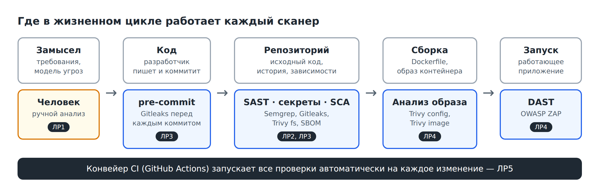

# Практикум по безопасной разработке (DevSecOps)

Пять лабораторных работ для специалистов по информационной безопасности. Цель — научиться **работать со сканерами безопасности и встраивать их в конвейер CI**.

В первых четырёх работах студент знакомится с методами и инструментами по одному: запускает сканер, читает и разбирает отчёт, отсеивает ложные срабатывания, настраивает порог. В пятой собирает всё изученное в автоматический конвейер GitHub Actions.

Программировать не нужно. Исправления кода лежат готовыми в `solutions/`: студент применяет их одной командой и проверяет сканером, что находка устранена.

> Приложение намеренно уязвимо. Работайте только с локальной копией на своём компьютере. Не сканируйте чужие системы и не используйте настоящие секреты.



## Лабораторные работы

| № | Тема | Методы и инструменты | Время | Методичка | Для печати |
|---|---|---|---|---|---|
| 1 | Введение в DevSecOps: стенд, ручные атаки, модель угроз | SDLC, STRIDE, ручной анализ | 2 ч | [lab1](labs/lab1-secure-sdlc.md) | [DOCX](methodical/ЛР1_Введение_и_модель_угроз.docx) · [PDF](methodical/pdf/ЛР1_Введение_и_модель_угроз.pdf) |
| 2 | Статический анализ кода | SAST — Semgrep | 2 ч | [lab2](labs/lab2-sast-semgrep.md) | [DOCX](methodical/ЛР2_SAST_Semgrep.docx) · [PDF](methodical/pdf/ЛР2_SAST_Semgrep.pdf) |
| 3 | Что лежит в репозитории: секреты и зависимости | Gitleaks, pre-commit; SCA — Trivy, SBOM | 4 ч | [lab3](labs/lab3-secrets-gitleaks.md) | [DOCX](methodical/ЛР3_Секреты_и_зависимости.docx) · [PDF](methodical/pdf/ЛР3_Секреты_и_зависимости.pdf) |
| 4 | То, что запускается: контейнер и DAST | Trivy config и image; DAST — OWASP ZAP | 4 ч | [lab4](labs/lab4-sca-trivy-containers.md) | [DOCX](methodical/ЛР4_Контейнер_и_DAST.docx) · [PDF](methodical/pdf/ЛР4_Контейнер_и_DAST.pdf) |
| 5 | Конвейер безопасности | GitHub Actions: всё вместе | 4 ч | [lab5](labs/lab5-dast-github-actions.md) | [DOCX](methodical/ЛР5_GitHub_Actions.docx) · [PDF](methodical/pdf/ЛР5_GitHub_Actions.pdf) |

Шаблон отчёта: [labs/report-template.md](labs/report-template.md) · [DOCX](methodical/Шаблон_отчёта.docx).

Всего 16 академических часов. Работы выполняются **строго по порядку** в одном и том же репозитории студента. Каждая оценивается из 100 баллов.

## Как устроена каждая методичка

1. **Цель работы** — что студент будет уметь.
2. **Теория** — с рисунками и таблицами: как работает метод, что он видит и чего не видит, как читать результат.
3. **Ход работы** — шаги вида «команда → разбор параметров → что увидите (со снимком экрана) → что внести в отчёт».
4. **Команды для конвейера** — как изученное будет выглядеть в CI (ЛР2–ЛР4).
5. **Требования к отчёту, контрольные вопросы, критерии оценивания, источники.**

Навыки работы со сканером, которые повторяются от работы к работе:

| Навык | ЛР2 Semgrep | ЛР3 Gitleaks | ЛР3–4 Trivy | ЛР4 ZAP |
|---|---|---|---|---|
| Запуск и чтение отчёта | ✔ | ✔ | ✔ | ✔ |
| Разбор: настоящее или ложное | ✔ | ✔ | ✔ | ✔ |
| Подавление с обоснованием | `--exclude-rule` | `.gitleaksignore` | `--ignore-unfixed` | `IGNORE` в файле правил |
| Порог и код завершения | `--error` | код 1 при находке | `--exit-code 1` | `FAIL` в файле правил |
| Проверка исправления повторным запуском | ✔ | ✔ | ✔ | ✔ |
| Чего сканер не видит | IDOR | слабый ключ по умолчанию | порт в Compose | IDOR, страницы после входа |

## Что понадобится студенту

- Git;
- Python 3.11 или новее;
- Docker Desktop (Windows, macOS) или Docker Engine (Linux) — с ЛР3;
- учётная запись на github.com — для ЛР5.

Команды написаны для Bash. В Windows используется Git Bash; перед командами `docker run` в нём нужно выполнить `export MSYS_NO_PATHCONV=1` (в методичках это указано).

## Структура репозитория

```text
secure-development-labs/
├── labs/                   # методички в Markdown — основной источник
│   └── img/                #   схемы и снимки экрана
├── methodical/             # те же методички в DOCX и PDF
├── solutions/              # готовые исправления, которые применяет студент
│   ├── lab2/               #   SQL-инъекции, XSS, отладочный режим, тесты
│   ├── lab3-secrets/       #   секрет вынесен в переменные окружения
│   ├── lab3-deps/          #   обновление Flask
│   ├── lab4-container/     #   Dockerfile без root, порт БД закрыт
│   ├── lab4-access/        #   контроль доступа к профилю, заголовки, тесты
│   └── reference-pipeline/ #   эталонный конвейер для преподавателя
├── tools/build_guides.sh   # пересборка DOCX из Markdown
└── vulnerable-app/         # учебное приложение — его копирует студент
```

Студент клонирует репозиторий, копирует `vulnerable-app` в собственный каталог `~/devsecops-lab` и дальше работает только там. Исправление применяется так:

```bash
cp -r ../secure-development-labs/solutions/lab2/. .
```

Методички правятся в `labs/*.md`. DOCX пересобирается командой `bash tools/build_guides.sh` (нужен pandoc), PDF получают из DOCX через «Сохранить как».

## Заложенные уязвимости

| Дефект | Где | Кто находит | Где устраняется |
|---|---|---|---|
| SQL-инъекция | `/login`, `/search` | Semgrep, вручную | ЛР2 |
| Отражённый и хранимый XSS | `search.html`, `comments.html` | Semgrep (свои правила), вручную | ЛР2 |
| Отладочный режим Flask | `backend/app.py` | Semgrep | ЛР2 |
| Токен в коде и в истории Git | `backend/config.py` | Gitleaks, Semgrep (свои правила) | ЛР3 |
| Уязвимые версии библиотек | `legacy-component/`, `requirements.txt` | Trivy fs | ЛР3 |
| Контейнер работает от root | `Dockerfile` | Trivy config (DS-0002) | ЛР4 |
| Открытый порт PostgreSQL | `compose.yaml` | только вручную | ЛР4 |
| Уязвимости базового образа | `python:3.11-slim` | Trivy image | не устраняется, разбор порога |
| Нет заголовков безопасности | все ответы | OWASP ZAP | ЛР4 |
| IDOR: чужой профиль без входа | `/profile?id=` | только вручную | ЛР4 |
| Нет защиты от CSRF | формы | OWASP ZAP | остаточный риск |
| Пароли в открытом виде | таблица `users` | только вручную | остаточный риск |
| Ключ сессии по умолчанию | `backend/config.py` | только вручную | остаточный риск |

Часть дефектов намеренно не находит ни один сканер — на этом построены задания об ограничениях инструментов.

## Контрольные результаты для преподавателя

Получены при полном прохождении всех шагов на Ubuntu 24.04 (Python 3.12, Docker 29) в ноябре 2026 года. Версии закреплены: Semgrep 1.185.0, Gitleaks 8.24.2, Trivy 0.76.2; ZAP — образ `stable` (2.17.0).

| Работа | Проверка | До исправления | После |
|---|---|---|---|
| ЛР1 | `pytest -q` | 4 passed | — |
| ЛР2 | Semgrep, свои правила | 6 находок (3 с `--severity ERROR`) | 1 (токен, уходит в ЛР3) |
| ЛР2 | Semgrep, `p/default` | около 18 | около 8; без ложного `sqlalchemy-execute-raw-query` — около 4 |
| ЛР2 | `pytest -q` | — | 7 passed |
| ЛР3-А | `gitleaks dir` | 1 (`generic-api-key`, `config.py:3`) | 0 |
| ЛР3-А | `gitleaks git` | 1 | 1 до `.gitleaksignore`, затем 0 |
| ЛР3-Б | `trivy fs` | 44 в `legacy-component`, 1 в `requirements.txt`; код 1 с порогом | 0 HIGH/CRITICAL, код 0 |
| ЛР3-Б | SBOM по файлам | 9 компонентов | 4 |
| ЛР4-А | `trivy config` | DS-0002 (HIGH) | 0 |
| ЛР4-А | `id` в контейнере | `uid=0(root)` | `uid=1000(labuser)` |
| ЛР4-А | `trivy image` | 49 HIGH в Debian, с исправлением — 2 | не устраняется |
| ЛР4-А | SBOM по образу | около 120 компонентов | — |
| ЛР4-Б | ZAP baseline | 10 WARN | 6 WARN; с файлом правил — 4 WARN, 2 IGNORE, код 0 |
| ЛР4-Б | `/profile?id=1` без входа | 200 | 401 |
| ЛР4-Б | `pytest` | 7 passed | 11 passed |
| ЛР5 | история | 7 коммитов перед публикацией | — |
| ЛР5 | конвейер | — | 5 заданий; PR с `\|safe` — красные `tests` и `sast`, `dast` пропущен |

Числа для `p/default` и Trivy со временем меняются: правила в реестре Semgrep и база уязвимостей обновляются. Это обсуждается в методичках. Если после выхода новой CVE порог в ЛР3 перестанет проходить, обновите версию библиотеки в `solutions/lab3-deps/requirements.txt`.

Признаки самостоятельной работы: у каждого студента свои идентификаторы коммитов, свой отпечаток в `.gitleaksignore`, своя ссылка на репозиторий и свои запуски на вкладке Actions.

## Служебный конвейер репозитория курса

Workflow `.github/workflows/container-checks.yml` проверяет учебное приложение в исходном виде и публикует образ `ghcr.io/univerdvfu/secure-dev-lab-app`. Студенты копируют себе только `vulnerable-app`, поэтому он к ним не попадает: свой конвейер они собирают в ЛР5.
