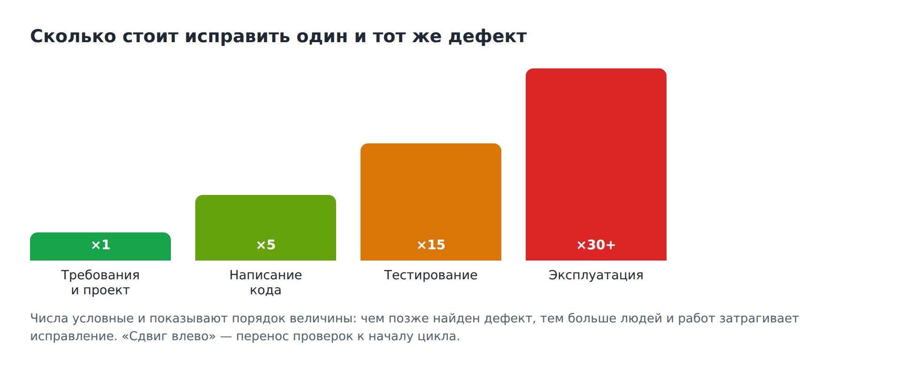
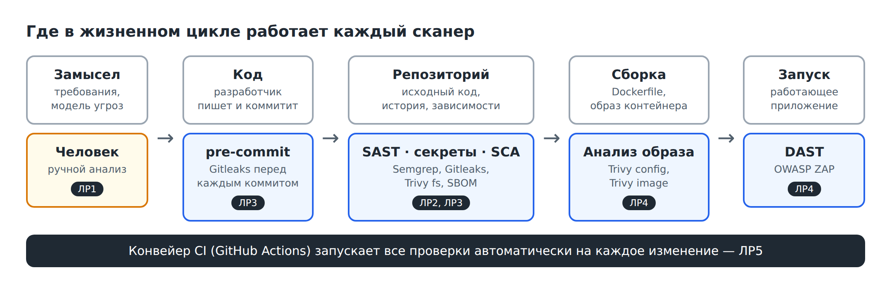
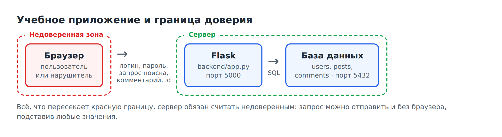
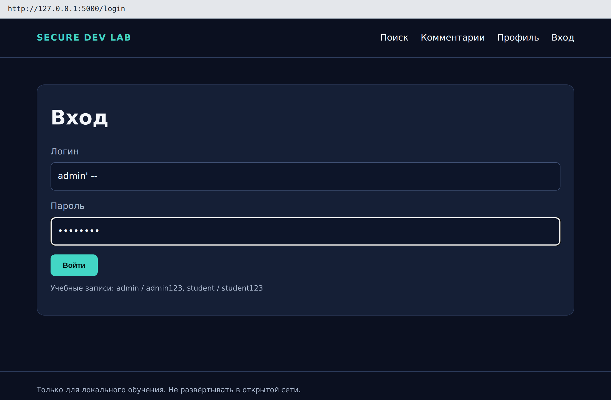
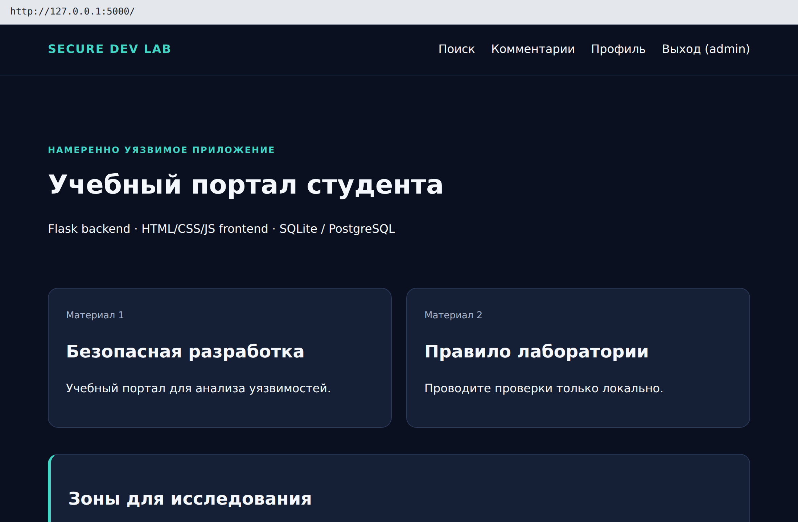
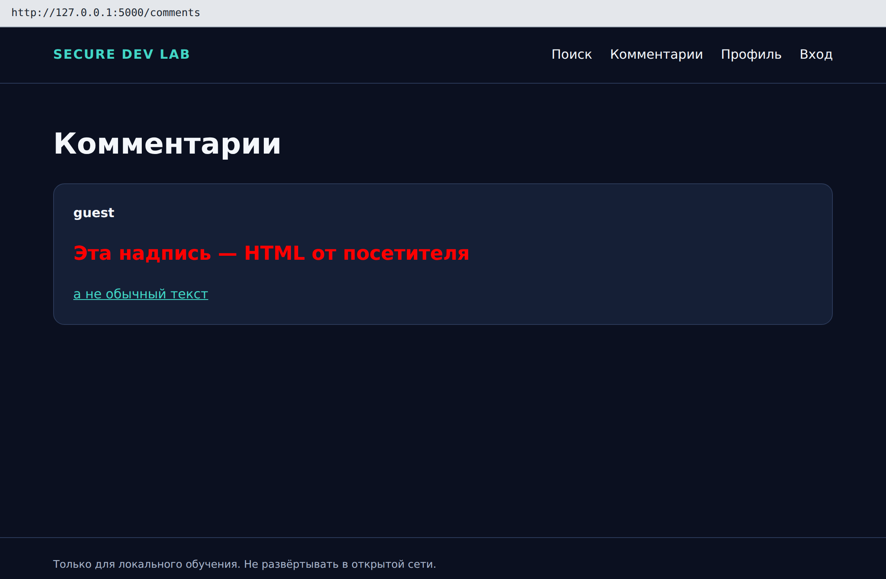
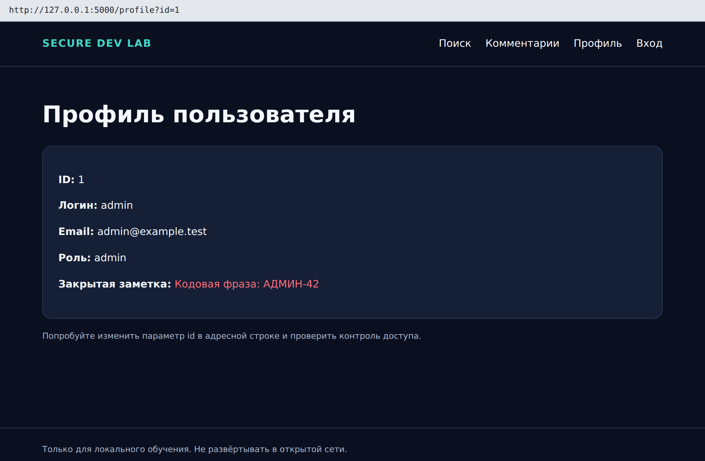

# Лабораторная работа №1. Введение в DevSecOps: стенд, ручные атаки, модель угроз

**Время:** 2 академических часа.

**Что получится:** рабочее окружение на вашем ноутбуке, свой Git-репозиторий с уязвимым приложением, три уязвимости, подтверждённые собственными руками, и модель угроз с планом проверок на весь практикум.

Программировать не нужно. Все команды копируются из методички.

> Приложение намеренно уязвимо. Запускайте его только на своём компьютере. Чужие системы не сканируйте и не атакуйте.

---

## 1. Цель работы

Понять, как устроена безопасная разработка и какое место в ней занимают сканеры; подготовить стенд; увидеть уязвимости «вживую» до того, как их покажет инструмент.

После работы вы сможете:

- объяснить, что такое DevSecOps и «сдвиг влево»;
- назвать виды автоматических проверок безопасности и сказать, что каждая из них видит и чего не видит;
- показать на схеме приложения границу доверия;
- провести три типовые атаки на веб-приложение и объяснить их причину;
- составить реестр активов, таблицу угроз и план проверок.

## 2. Теория

### 2.1. Жизненный цикл программы и цена ошибки

Любая программа проходит одни и те же этапы: замысел и требования → проектирование → написание кода → тестирование → выпуск → эксплуатация. Эту последовательность называют SDLC (Software Development Life Cycle).

Традиционно безопасность проверяли в самом конце, перед выпуском: приходил специалист, находил проблемы, и релиз откладывался. У такого подхода два недостатка. Во-первых, поздно найденная ошибка дорого стоит: чтобы её исправить, нужно вернуться на несколько этапов назад. Во-вторых, проверка раз в полгода не успевает за разработкой, которая выпускает изменения каждый день.



Отсюда идея **«сдвига влево» (shift left)**: проверки безопасности переносят как можно ближе к началу цикла и запускают как можно чаще.

### 2.2. DevSecOps

**DevOps** — практика, при которой сборка, тестирование и развёртывание программы автоматизированы и запускаются на каждое изменение кода. Цепочку этих автоматических шагов называют **конвейером** (pipeline).

**DevSecOps** — тот же конвейер, в который встроены проверки безопасности. Главные принципы:

1. **Автоматически.** Проверка запускается сама на каждое изменение, а не «когда вспомнили».
2. **Быстро.** Разработчик узнаёт о проблеме через минуты, пока помнит, что менял.
3. **С последствиями.** Результат проверки влияет на судьбу изменения: опасный код не попадает в основную ветку.
4. **Человек решает.** Сканер находит, а решение — исправить, принять риск или признать ложной тревогой — принимает специалист и фиксирует письменно.

Роль специалиста по безопасности здесь меняется. Он не «проверяющий в конце», а тот, кто выбирает сканеры, настраивает правила и пороги, разбирает находки и объясняет разработчикам, что и почему нужно исправить. Именно этому посвящён практикум.

### 2.3. Какие бывают автоматические проверки



| Вид проверки | Что анализирует | Что находит | Чего не видит | Инструмент в практикуме |
|---|---|---|---|---|
| **SAST** — статический анализ | исходный код, без запуска | опасные конструкции: SQL-инъекции, отключённое экранирование | настройки запуска, права доступа, логику | Semgrep, ЛР2 |
| **Поиск секретов** | файлы и историю Git | пароли, токены, ключи | слабые, но «неслучайные» пароли | Gitleaks, ЛР3 |
| **SCA** — анализ состава | списки библиотек, образ контейнера | известные уязвимости в чужом коде | ошибки в вашем собственном коде | Trivy, ЛР3–ЛР4 |
| **Анализ конфигурации** | Dockerfile и подобные файлы | небезопасные настройки | то, для чего нет правила | Trivy, ЛР4 |
| **DAST** — динамический анализ | работающее приложение, снаружи | заголовки, поведение сервера | код; страницы, до которых не дошёл | OWASP ZAP, ЛР4 |

Обратите внимание на колонку «Чего не видит». Ни один инструмент не находит всё — поэтому их несколько, и поэтому остаётся работа для человека. К этой таблице вы будете возвращаться в каждой работе.

### 2.4. Что говорит ГОСТ

**ГОСТ Р 56939-2024** «Защита информации. Разработка безопасного программного обеспечения. Общие требования» описывает процессы, которые должен выстроить разработчик безопасного ПО. Среди них: формирование требований безопасности, моделирование угроз, статический анализ, динамический анализ, композиционный анализ (проверка заимствованных компонентов), поиск секретов в коде, управление недостатками.

**ГОСТ Р 71207-2024** детализирует требования к статическому анализу — он понадобится в ЛР2.

Соответствие практикума стандарту:

| Процесс по ГОСТ Р 56939-2024 | Где отрабатывается |
|---|---|
| Моделирование угроз | ЛР1 |
| Статический анализ исходного кода | ЛР2 |
| Поиск секретов, композиционный анализ | ЛР3 |
| Анализ образов контейнеров, динамический анализ | ЛР4 |
| Встраивание проверок в процесс сборки | ЛР5 |

Важная оговорка: выполнение лабораторных не делает проект «соответствующим ГОСТу». Стандарт требует выстроенных процессов в организации — с регламентами, ответственными и документами. Мы осваиваем отдельные практики.

### 2.5. Граница доверия

Учебное приложение — небольшой сайт: вход, поиск, комментарии, профиль пользователя. Устроено оно так же, как большинство веб-приложений.



**Граница доверия** — место, где данные переходят от одной стороны к другой и принимающая сторона не может быть уверена в отправителе. Главная граница — между браузером и сервером.

Всё, что приходит из браузера, — поля форм, параметры в адресной строке, cookie — сервер обязан считать недоверенным. Нарушителю не нужен браузер: он может отправить запрос любой программой и подставить любые значения. Отсюда правило:

> Проверки в браузере — это удобство. Защита — только на сервере.

Все три атаки этой работы — следствие того, что сервер поверил данным из браузера.

### 2.6. Три класса уязвимостей, которые вы увидите

**SQL-инъекция.** Приложение составляет запрос к базе данных, вклеивая в его текст то, что ввёл пользователь. Если ввести не имя, а кусок SQL-команды, база выполнит его как команду. Результат — вход без пароля, чтение и изменение чужих данных.

**XSS (межсайтовое выполнение сценариев).** Приложение вставляет текст пользователя в страницу как HTML-разметку. Если написать в комментарии тег со сценарием, браузер каждого посетителя выполнит его — от имени сайта, с доступом к данным этого посетителя.

**IDOR (небезопасная прямая ссылка на объект).** Приложение выдаёт объект по номеру из адреса (`/profile?id=2`) и не проверяет, имеет ли запрашивающий право его видеть. Достаточно поменять число.

Первые две — ошибки обработки данных: их причина видна в коде, и сканеры умеют такое находить. Третья — ошибка логики: код технически корректен, нарушено правило «кому что можно». Запомните это различие — оно определит, что найдут сканеры.

### 2.7. Как описывают угрозы: активы и STRIDE

Прежде чем что-то защищать, нужно понять, **что** защищаем и **от чего**.

**Актив** — то, что имеет ценность: данные пользователей, секреты, работоспособность сервиса.

**Угроза** — то, что нарушитель может сделать с активом. Чтобы не придумывать угрозы «из головы», используют чек-листы. Самый известный — **STRIDE**, шесть категорий по первым буквам:

| Буква | Категория | Вопрос к себе | Пример |
|---|---|---|---|
| **S** | Spoofing — подмена личности | Можно ли выдать себя за другого? | вход без пароля |
| **T** | Tampering — изменение данных | Можно ли изменить то, что менять нельзя? | внедрение SQL |
| **R** | Repudiation — отказ от действий | Можно ли действовать, не оставив следов? | нет журнала входов |
| **I** | Information disclosure — раскрытие | Можно ли прочитать чужое? | чужой профиль |
| **D** | Denial of service — отказ в обслуживании | Можно ли сломать сервис для всех? | перегрузка запросами |
| **E** | Elevation of privilege — повышение прав | Можно ли получить больше прав? | студент становится администратором |

## 3. Что установить

| Программа | Зачем | Проверка в терминале |
|---|---|---|
| Git | хранение кода | `git --version` |
| Python 3.11 или новее | запуск приложения и Semgrep | `python --version` |
| Docker Desktop (Windows, macOS) или Docker Engine (Linux) | сканеры Gitleaks, Trivy, ZAP — с ЛР3 | `docker run --rm hello-world` |
| Редактор кода, например VS Code | просмотр файлов | — |
| Учётная запись на github.com | понадобится в ЛР5 | — |

**Терминал.** В Windows используйте **Git Bash** (ставится вместе с Git), в Linux и macOS — обычный терминал.

## 4. Ход работы

### Шаг 1. Проверить инструменты

```bash
git --version
python --version
docker --version
```

**Что увидите:** три строки с версиями; Python не ниже 3.11.

Если `python: command not found` (Linux, macOS) — используйте `python3` здесь и на шаге 3.

**В отчёт:** вывод команд.

### Шаг 2. Создать свой репозиторий

Вы будете работать с проектом пять занятий и в конце опубликуете его на GitHub. Поэтому сразу заведите собственный репозиторий.

```bash
cd ~
git clone https://github.com/univerdvfu/secure-development-labs.git
cp -r secure-development-labs/vulnerable-app devsecops-lab
cd devsecops-lab

git init -b main
git config user.name "Имя Фамилия"
git config user.email "ваша_почта@example.com"
git add .
git commit -m "Initial vulnerable training app"
git log --oneline
```

Что произошло:

| Команда | Смысл |
|---|---|
| `git clone …` | скачать материалы курса |
| `cp -r … devsecops-lab` | скопировать учебное приложение в отдельную папку |
| `git init -b main` | сделать эту папку Git-репозиторием с веткой `main` |
| `git add .` и `git commit` | сохранить текущее состояние файлов как первый коммит |

В итоге у вас две папки:

- `~/secure-development-labs` — материалы курса и готовые исправления. **Не меняйте её.**
- `~/devsecops-lab` — **ваш проект**. Все команды всех работ выполняются в нём.

**Что увидите:** одна строка — ваш первый коммит с уникальным идентификатором.

**В отчёт:** вывод `git log --oneline`.

### Шаг 3. Запустить приложение

```bash
python -m venv .venv
source .venv/Scripts/activate     # Windows, Git Bash
# source .venv/bin/activate       # Linux и macOS
python -m pip install -r requirements.txt -r requirements-dev.txt
python -m backend.app
```

`.venv` — виртуальное окружение: отдельная папка с пакетами Python только для этого проекта. После активации в начале строки терминала появляется `(.venv)`.

> Окружение нужно активировать в каждом новом окне терминала — той же командой `source …`.

**Что увидите:** `Running on http://127.0.0.1:5000`. Терминал не закрывайте: в нём работает сервер. Остановка — `Ctrl+C`.

Откройте <http://127.0.0.1:5000>.


Учётные записи: `student / student123` и `admin / admin123`.

Если не получилось:

- **Порт 5000 занят.** В macOS его занимает AirPlay: отключите «Приёмник AirPlay» в системных настройках.
- **Ошибка сети при установке пакетов** — повторите команду `pip install`.

Обратите внимание на строки в терминале `Debug mode: on` и `Running on all addresses (0.0.0.0)`. Приложение в отладочном режиме доступно всем в вашей сети. Это одна из заложенных проблем. До её исправления в ЛР2 не запускайте приложение в общественных сетях.

**В отчёт:** снимок экрана главной страницы.

### Шаг 4. Атака 1 — вход без пароля (SQL-инъекция)

Откройте `/login`. В поле «Логин» введите `admin' -- ` (одинарная кавычка, пробел, два дефиса, пробел). Пароль — любой.



Нажмите «Войти».



**Что увидите:** справа вверху «Выход (admin)» — вы вошли как администратор, не зная пароля.

**Почему так вышло.** Сервер собирает запрос к базе, вклеивая в него логин и пароль:

```sql
SELECT … FROM users WHERE username = 'ЛОГИН' AND password = 'ПАРОЛЬ'
```

После подстановки вашего логина получилось:

```sql
SELECT … FROM users WHERE username = 'admin' -- ' AND password = '…'
```

Кавычка закрыла строку раньше времени, а `--` в SQL начинает комментарий. Проверка пароля исчезла из запроса.

**В отчёт:** снимок экрана после входа и объяснение своими словами в одном-двух предложениях.

### Шаг 5. Атака 2 — внедрение разметки (XSS)

Выйдите из системы. Откройте `/comments` и отправьте комментарий:

```text
<h2 style="color:red">Эта надпись — HTML от посетителя</h2><u>а не обычный текст</u>
```



**Что увидите:** крупный красный заголовок. Сайт не показал ваш текст, а **выполнил** его как часть страницы.

Теперь отправьте второй комментарий — со сценарием:

```text

```

**Что увидите:** всплывающее окно. Оно будет появляться у каждого, кто откроет страницу: сценарий сохранён в базе данных. Такой XSS называют **хранимым**. На месте безобидного `alert` мог быть код, который отправляет нарушителю данные посетителя.

То же самое есть на странице поиска: введите там `<b>проверка</b>` — слово в строке «Запрос» станет жирным. Это **отражённый** XSS: вредоносный текст приходит в запросе и сразу возвращается в ответе.

**В отчёт:** снимок экрана и ответ: чем хранимый XSS опаснее отражённого?

### Шаг 6. Атака 3 — чужой профиль (IDOR)

Не входя в систему, откройте `/profile?id=1`.



**Что увидите:** почту и «закрытую заметку» администратора. Поменяйте `id=1` на `id=3` — увидите данные другого студента.

**Почему так вышло.** Сервер показывает профиль с тем номером, который указан в адресе, и не проверяет, кто спрашивает. Взлом здесь не нужен: достаточно поменять одну цифру.

**В отчёт:** снимок экрана и ответ: какую проверку должен был сделать сервер?

### Шаг 7. Осмотреть проект

Откройте каталог `~/devsecops-lab` в редакторе. Писать код не нужно — нужно знать, где что лежит: сканеры будут ссылаться на эти файлы и строки.

| Файл | Что в нём | Что найти |
|---|---|---|
| `backend/app.py` | логика сайта: вход, поиск, комментарии, профиль | последнюю строку с `debug=True`; строку с `SELECT … WHERE username = '{username}'` |
| `backend/config.py` | настройки | строку `DEMO_GITHUB_TOKEN` |
| `backend/database.py` | таблицы и начальные данные | в каком виде хранятся пароли |
| `frontend/templates/*.html` | страницы | слово `safe` в `search.html` и `comments.html` |
| `requirements.txt` | список библиотек приложения | — |
| `legacy-component/requirements.txt` | список библиотек старого компонента | — |
| `Dockerfile`, `compose.yaml` | запуск в контейнере | раздел `ports` у сервиса `db` |
| `.semgrep.yml`, `.pre-commit-config.yaml` | настройки сканеров | — |

**В отчёт:** в каком виде хранятся пароли в `database.py` и почему это проблема.

### Шаг 8. Составить реестр активов

Что в этом приложении нужно защищать? Заполните таблицу.

| Актив | Где находится | Что будет при раскрытии | Что будет при изменении | Важность |
|---|---|---|---|---|
| Закрытая заметка | таблица `users` | посторонний узнаёт личные данные | владелец видит чужой текст | высокая |
| Пароли пользователей | | | | |
| Адреса электронной почты | | | | |
| Токен в `config.py` | | | | |
| Комментарии | | | | |
| Работоспособность сайта | | | | |

**В отчёт:** реестр активов.

### Шаг 9. Описать угрозы и спланировать проверки

Теперь главное задание работы. Для каждой проблемы определите категорию STRIDE и предположите, каким видом проверки её можно найти. Воспользуйтесь таблицей из раздела 2.3.

Это **гипотеза**. В следующих работах вы проверите её на практике, а в ЛР5 сравните с тем, что получилось на самом деле.

| № | Проблема | Где | Категория STRIDE | Какой актив страдает | Кто должен найти: SAST / секреты / SCA / конфигурация / DAST / только человек |
|---|---|---|---|---|---|
| 1 | SQL-инъекция | `/login`, `/search` | S, T | пароли, все данные | |
| 2 | XSS | `/comments`, `/search` | | | |
| 3 | Чужой профиль без входа | `/profile?id=` | | | |
| 4 | Отладочный режим | `app.py` | | | |
| 5 | Токен в коде | `config.py` | | | |
| 6 | Старые библиотеки | `legacy-component` | | | |
| 7 | Открыт порт базы данных | `compose.yaml` | | | |
| 8 | Пароли открытым текстом | база данных | | | |

**В отчёт:** заполненная таблица.

### Шаг 10. Завершить

Остановите сервер (`Ctrl+C`) и убедитесь, что файлы проекта не изменены:

```bash
git status
```

**Что увидите:** `nothing to commit, working tree clean`. Папки `.venv` и `data` Git не показывает: они перечислены в `.gitignore`.

## 5. Требования к отчёту

Отчёт оформляется по [шаблону](report-template.md):

1. Версии инструментов и вывод `git log --oneline`.
2. Снимок экрана работающего приложения.
3. Три атаки: снимок экрана и объяснение причины каждой.
4. Ответ о хранении паролей.
5. Реестр активов.
6. Таблица угроз и плана проверок.
7. Ответы на контрольные вопросы.

## 6. Контрольные вопросы

1. Что означает «сдвиг влево» и почему раннее обнаружение дефекта дешевле?
2. Чем DevSecOps отличается от проверки безопасности перед выпуском?
3. Чем SAST отличается от DAST? Что видит только каждый из них?
4. Что такое граница доверия? Почему проверки в браузере не защищают сервер?
5. Чем SQL-инъекция и XSS принципиально отличаются от IDOR?
6. Какую из восьми проблем, по вашему мнению, не найдёт ни один сканер? Почему?

## 7. Критерии оценивания

| Критерий | Баллы |
|---|---|
| Окружение, репозиторий, запуск приложения | 15 |
| Три атаки с объяснением причин | 30 |
| Реестр активов | 15 |
| Таблица угроз и плана проверок | 25 |
| Контрольные вопросы | 15 |
| **Итого** | **100** |

## 8. Источники

- ГОСТ Р 56939-2024. Защита информации. Разработка безопасного программного обеспечения. Общие требования.
- ГОСТ Р 71207-2024. Защита информации. Разработка безопасного программного обеспечения. Статический анализ программного обеспечения. Общие требования.
- OWASP Top 10: <https://owasp.org/www-project-top-ten/>
- OWASP Threat Modeling: <https://owasp.org/www-community/Threat_Modeling>
