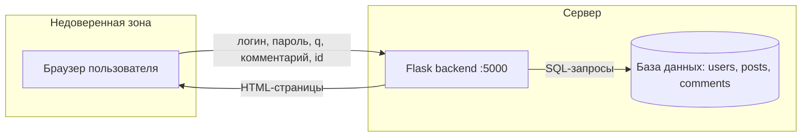

# Лабораторная работа №1. Безопасный цикл разработки и модель угроз

**Тема:** безопасный SDLC, DevSecOps, активы, границы доверия, угрозы и проверяемые требования.
**Время:** 2 академических часа.
**Результат:** рабочее окружение на вашем ноутбуке, собственный Git-репозиторий с учебным приложением и модель угроз, на которую опираются все следующие работы.

> Приложение намеренно уязвимо. Запускайте его только на своём компьютере, не подключайте к нему настоящие данные и не сканируйте чужие системы.

---

## 1. Цель работы

Научиться смотреть на приложение глазами специалиста по безопасности: понять, что в нём нужно защищать, откуда приходят недоверенные данные, что может сделать нарушитель и какие требования нужно предъявить разработке.

После работы вы сможете:

- объяснить, чем DevSecOps отличается от «проверки безопасности перед релизом»;
- нарисовать схему приложения с границами доверия;
- составить реестр активов и таблицу угроз по методике STRIDE;
- сформулировать требования безопасности так, чтобы их можно было проверить тестом или сканером.

## 2. Теория

### 2.1. SDLC и «сдвиг влево»

SDLC (Software Development Life Cycle) — жизненный цикл программы: требования → проектирование → разработка → тестирование → выпуск → сопровождение.

В классическом подходе безопасность проверяют в самом конце, перед выпуском. Проблема в цене ошибки: дефект, найденный на этапе требований, исправляется одной строкой в документе, а тот же дефект в работающей системе — это переписывание кода, повторное тестирование и, возможно, уже случившаяся утечка.

Поэтому проверки «сдвигают влево» — ближе к началу цикла. Это называют **shift left**.

### 2.2. DevSecOps

DevOps — практика, в которой сборка, тестирование и развёртывание автоматизированы и запускаются на каждое изменение кода. DevSecOps добавляет в этот конвейер проверки безопасности. Ключевые идеи:

- проверки запускаются автоматически, а не «когда вспомнили»;
- разработчик узнаёт о проблеме через минуты после коммита, а не через месяц;
- результат проверки влияет на судьбу изменения: опасный код не попадает в основную ветку;
- инструмент находит дефект, но решение (исправить, принять риск, признать ложным срабатыванием) принимает человек и фиксирует его письменно.

В практикуме вы пройдёте весь этот путь:

| Работа | Практика | Инструмент | Что находит |
|---|---|---|---|
| ЛР1 | Моделирование угроз | голова, схема, таблицы | ошибки замысла и логики |
| ЛР2 | SAST — статический анализ кода | Semgrep | опасные конструкции в исходном коде |
| ЛР3 | Поиск секретов | Gitleaks, pre-commit | пароли и токены в коде и истории Git |
| ЛР4 | SCA — анализ состава ПО | Trivy, SBOM | уязвимые зависимости, ошибки Dockerfile |
| ЛР5 | DAST и конвейер CI | OWASP ZAP, GitHub Actions | дефекты работающего приложения; всё вместе автоматически |

### 2.3. Что говорит ГОСТ

**ГОСТ Р 56939-2024** «Защита информации. Разработка безопасного программного обеспечения. Общие требования» описывает процессы, которые должен выстроить разработчик безопасного ПО. Среди них — формирование требований безопасности, моделирование угроз, статический и динамический анализ, композиционный анализ (проверка заимствованных компонентов), поиск секретов в коде, управление недостатками. Каждая работа практикума отрабатывает один-два таких процесса.

**ГОСТ Р 71207-2024** «Защита информации. Разработка безопасного программного обеспечения. Статический анализ программного обеспечения. Общие требования» детализирует требования к статическому анализу — он понадобится в ЛР2.

Важная оговорка: выполнение лабораторных не делает проект «соответствующим ГОСТу». Стандарт требует выстроенных процессов в организации — с регламентами, ответственными и артефактами. Мы осваиваем отдельные практики и привычку документировать решения.

### 2.4. Активы и границы доверия

**Актив** — то, что имеет ценность и что нужно защищать: данные (пароли, почта, личные заметки), секреты (токены, ключи), сама работоспособность сервиса.

**Граница доверия** — место, где данные переходят от одного компонента к другому, причём принимающая сторона не может быть уверена в отправителе. Главная граница любого веб-приложения — между браузером и сервером. Всё, что пришло из браузера (поля формы, параметры адресной строки, cookie, заголовки), считается недоверенным: нарушитель может отправить запрос вообще без браузера и подставить любые значения.

Отсюда правило: **проверки в браузере — это удобство, а не защита. Защита — только на сервере.**

### 2.5. Уязвимость, угроза, риск

- **Уязвимость** — конкретный дефект. Пример: SQL-запрос собирается склейкой строк.
- **Угроза** — то, что нарушитель может сделать, используя уязвимость. Пример: войти под администратором без пароля.
- **Риск** — оценка «насколько это вероятно и насколько больно». Зависит от контекста: одна и та же уязвимость в закрытом стенде и в интернет-банке — это разный риск.

### 2.6. STRIDE

Чтобы не придумывать угрозы «из головы», используют чек-листы. STRIDE — шесть категорий, по которым проверяют каждый элемент схемы:

| Буква | Категория | Вопрос к себе | Пример для веб-приложения |
|---|---|---|---|
| **S** | Spoofing — подмена личности | Можно ли выдать себя за другого? | вход без знания пароля |
| **T** | Tampering — изменение данных | Можно ли изменить то, что менять нельзя? | внедрение SQL, подмена параметра |
| **R** | Repudiation — отказ от действий | Можно ли сделать что-то и не оставить следов? | нет журнала входов |
| **I** | Information disclosure — раскрытие | Можно ли прочитать чужое? | чужой профиль по номеру в адресе |
| **D** | Denial of service — отказ в обслуживании | Можно ли сломать сервис для всех? | тяжёлый запрос без ограничений |
| **E** | Elevation of privilege — повышение прав | Можно ли получить больше прав, чем выдано? | студент получает права администратора |

### 2.7. Каким должно быть требование безопасности

Требование должно быть проверяемым — по нему можно написать тест с результатом «выполнено / не выполнено».

| Плохо | Хорошо |
|---|---|
| Профиль должен быть защищён | На запрос `/profile` без входа сервер отвечает кодом 401; на запрос чужого профиля — 403 |
| Не должно быть SQL-инъекций | Все SQL-запросы передают пользовательские значения через параметры; правило Semgrep не находит f-строк в `execute` |
| Секреты хранить безопасно | В репозитории и его истории нет токенов: `gitleaks git` завершается с кодом 0 |

## 3. Что понадобится

Установите заранее (один раз на весь практикум):

| Программа | Зачем | Проверка в терминале |
|---|---|---|
| Git | хранение кода, с ЛР1 | `git --version` |
| Python 3.11 или новее | запуск приложения | `python --version` |
| Docker Desktop (Windows, macOS) или Docker Engine (Linux) | сканеры Gitleaks, Trivy, ZAP — с ЛР3 | `docker run --rm hello-world` |
| Редактор кода, например VS Code | чтение и правка файлов | — |
| Учётная запись на github.com | понадобится в ЛР5 | — |

**Терминал.** Все команды практикума написаны для Bash. В Windows используйте **Git Bash** (устанавливается вместе с Git), в Linux и macOS — обычный терминал. Там, где команда для Windows отличается, это указано отдельно.

## 4. Ход работы

### Шаг 1. Проверить инструменты

```bash
git --version
python --version
docker --version
```

Ожидаемый результат: три строки с номерами версий, Python не ниже 3.11.

Если не получилось:

- `python: command not found` в Linux/macOS — используйте `python3` в этой команде и в команде создания окружения на шаге 3.
- Docker ещё не установлен — ЛР1 и ЛР2 можно выполнить без него, но к ЛР3 он нужен.

**В отчёт:** вывод трёх команд.

### Шаг 2. Создать собственный репозиторий с приложением

Вы будете менять код от работы к работе, а в ЛР5 опубликуете его на GitHub. Поэтому сразу заведите отдельную папку со своим Git-репозиторием.

```bash
cd ~
git clone https://github.com/univerdvfu/secure-development-labs.git
cp -r secure-development-labs/vulnerable-app devsecops-lab
cd devsecops-lab

git init -b main
git config user.name "Имя Фамилия"
git config user.email "ваша_почта@example.com"
git add .
git commit -m "Initial vulnerable training app"
git log --oneline
```

Что произошло: папка `secure-development-labs` — это материалы курса, её вы больше не меняете. Папка `devsecops-lab` — ваш проект. Команда `git init` превратила её в репозиторий, а `git commit` сохранил исходное, уязвимое состояние.

Ожидаемый результат: `git log --oneline` показывает одну строку — ваш первый коммит.

> Дальше во всех работах «каталог проекта» — это `~/devsecops-lab`. Все команды выполняются в нём.

**В отчёт:** вывод `git log --oneline`.

### Шаг 3. Запустить приложение

```bash
python -m venv .venv
source .venv/Scripts/activate     # Windows, Git Bash
# source .venv/bin/activate       # Linux и macOS
python -m pip install -r requirements.txt -r requirements-dev.txt
python -m backend.app
```

Виртуальное окружение `.venv` — это отдельная папка с пакетами Python только для этого проекта. После активации в начале строки терминала появляется `(.venv)`. Активировать окружение нужно в каждом новом окне терминала.

Ожидаемый результат: в терминале строка `Running on http://127.0.0.1:5000`. Терминал не закрывайте — в нём работает сервер. Остановить его можно сочетанием `Ctrl+C`.

Откройте в браузере <http://127.0.0.1:5000>.

Если не получилось:

- **Порт 5000 занят.** В macOS его использует AirPlay: отключите «Приёмник AirPlay» в системных настройках. В остальных случаях найдите и завершите программу, занявшую порт.
- **Установка пакетов завершилась ошибкой сети** — повторите команду `pip install`.

> Обратите внимание на строки `Debug mode: on` и `Running on all addresses (0.0.0.0)`. Приложение доступно не только вам, но и всем в вашей сети, причём в отладочном режиме. Это одна из заложенных проблем — запомните её. До её исправления в ЛР2 не запускайте приложение в общественных сетях Wi-Fi.

**В отчёт:** снимок экрана главной страницы.

### Шаг 4. Изучить поведение приложения

Откройте **второй** терминал, перейдите в каталог проекта, активируйте окружение и запустите тесты:

```bash
cd ~/devsecops-lab
source .venv/Scripts/activate     # или .venv/bin/activate
pytest -q
```

Ожидаемый результат: `4 passed`. Эти тесты подтверждают, что уязвимости на месте: в следующих работах вы будете переписывать их так, чтобы они подтверждали защиту.

Теперь пройдите по приложению в браузере и заполните таблицу. Учётные записи: `student / student123` и `admin / admin123`.

| Адрес | Что делает | Какие данные принимает от пользователя | Нужен ли вход |
|---|---|---|---|
| `/` | | | |
| `/login` | | | |
| `/search` | | | |
| `/comments` | | | |
| `/profile?id=2` | | | |
| `/health` | | | |

Обязательно проделайте три опыта и запишите, что увидели:

1. Не входя в систему, откройте `/profile?id=1`, затем `/profile?id=3`.
2. В поиске введите `<b>проверка</b>` и посмотрите, как отобразилась строка «Запрос».
3. На странице комментариев отправьте комментарий `<i>курсив</i>`.

**В отчёт:** заполненная таблица маршрутов и по одному предложению о каждом опыте.

### Шаг 5. Прочитать код и нарисовать схему

Откройте в редакторе три файла и найдите в них ответы:

| Файл | Что найти |
|---|---|
| `backend/app.py` | функции `login`, `search`, `comments`, `profile`; как в каждой получаются данные пользователя (`request.form`, `request.args`) и куда они попадают дальше |
| `backend/database.py` | какие таблицы есть в базе и какие в них поля; в каком виде хранится пароль |
| `backend/config.py` | что хранится в переменных |
| `compose.yaml` | какие сервисы запускаются и какие порты открыты наружу |

Нарисуйте схему потоков данных. Подойдёт любой инструмент: [draw.io](https://app.diagrams.net), бумага и фотография, Mermaid. На схеме должны быть:

- компоненты: браузер, приложение Flask, база данных;
- стрелки с подписями — какие данные передаются;
- границы доверия пунктиром: как минимум «браузер ↔ сервер» и «сервер ↔ база данных»;
- открытые порты.

Заготовка в Mermaid — её можно вставить на <https://mermaid.live> и дополнить:



**В отчёт:** схема с границами доверия.

### Шаг 6. Составить реестр активов

Заполните таблицу — не менее шести активов. Первая строка дана как образец.

| Актив | Где находится | Что будет при раскрытии | Что будет при изменении | Важность |
|---|---|---|---|---|
| Закрытая заметка `secret_note` | таблица `users` | посторонний узнаёт личные данные | владелец видит чужой текст | высокая |
| Пароли пользователей | | | | |
| Адреса электронной почты | | | | |
| Токен в `config.py` | | | | |
| Ключ подписи сессии `FLASK_SECRET_KEY` | | | | |
| Комментарии | | | | |

Подсказка про ключ сессии: Flask подписывает им cookie с данными о входе. Подумайте, что сможет сделать человек, который знает этот ключ.

**В отчёт:** реестр активов.

### Шаг 7. Описать угрозы по STRIDE

Пройдите по схеме из шага 5 и для каждого маршрута задайте себе шесть вопросов STRIDE. Запишите не менее шести угроз, чтобы были представлены минимум четыре категории.

| № | Где | Категория STRIDE | Что делает нарушитель | Какой актив страдает | Как проверить |
|---|---|---|---|---|---|
| 1 | `/profile?id=` | I — раскрытие | меняет число в адресе и читает чужой профиль | почта, закрытая заметка | открыть `/profile?id=1` без входа |
| 2 | `/login` | | | | |
| 3 | `/search` | | | | |
| 4 | `/comments` | | | | |
| 5 | `config.py` | | | | |
| 6 | порт 5432 в `compose.yaml` | | | | |

Подсказки, куда смотреть в коде:

- как в `login` и `search` составляется текст SQL-запроса;
- что означает `|safe` в шаблонах `search.html` и `comments.html`;
- проверяет ли `profile`, кто именно делает запрос;
- последняя строка `app.py`.

**В отчёт:** таблица угроз.

### Шаг 8. Сформулировать требования и план проверок

Превратите угрозы в требования. Нужно не менее восьми требований по темам: SQL-запросы, вывод пользовательского текста, контроль доступа к профилю, хранение паролей, секреты в коде, заголовки безопасности, отладочный режим, порт базы данных.

| № | Требование (проверяемое) | Чем проверяется | В какой работе |
|---|---|---|---|
| Т1 | Пользовательские значения попадают в SQL только через параметры | Semgrep + тест с кавычкой в логине | ЛР2 |
| Т2 | | | |
| … | | | |

В колонке «Чем проверяется» используйте: автоматический тест, SAST (Semgrep), поиск секретов (Gitleaks), SCA (Trivy), DAST (ZAP), ручная проверка.

Эта таблица — ваш план на весь практикум. В ЛР5 вы вернётесь к ней и отметите, какие требования выполнены.

**В отчёт:** таблица требований.

### Шаг 9. Завершить работу

Остановите сервер (`Ctrl+C` в первом терминале). Код в этой работе не менялся, поэтому новый коммит не нужен. Убедитесь, что рабочая копия чистая:

```bash
git status
```

Ожидаемый результат: `nothing to commit, working tree clean`. Папки `.venv` и `data` Git не показывает — они перечислены в `.gitignore`.

## 5. Требования к отчёту

Отчёт оформляется по [шаблону](report-template.md) и содержит:

1. Версии инструментов (шаг 1) и вывод `git log --oneline` (шаг 2).
2. Снимок экрана работающего приложения (шаг 3).
3. Таблицу маршрутов и описание трёх опытов (шаг 4).
4. Схему потоков данных с границами доверия (шаг 5).
5. Реестр не менее шести активов (шаг 6).
6. Таблицу не менее шести угроз по STRIDE (шаг 7).
7. Не менее восьми проверяемых требований с планом проверок (шаг 8).
8. Вывод: 3–5 предложений о том, какие угрозы вы считаете самыми опасными и почему.

## 6. Контрольные вопросы

1. Что означает «сдвиг влево» и почему раннее обнаружение дефекта дешевле?
2. Чем уязвимость отличается от угрозы, а угроза — от риска?
3. Почему число `id` в адресной строке нельзя считать подтверждением права на доступ?
4. Почему проверки в браузере не защищают сервер?
5. Приведите пример непроверяемого требования и переформулируйте его в проверяемое.
6. Какие угрозы из вашей таблицы автоматический сканер, скорее всего, не найдёт? Почему?

## 7. Критерии оценивания

| Критерий | Баллы |
|---|---|
| Окружение, репозиторий, запуск приложения | 15 |
| Таблица маршрутов и схема с границами доверия | 20 |
| Реестр активов | 15 |
| Угрозы по STRIDE | 25 |
| Проверяемые требования и план проверок | 20 |
| Вывод и оформление | 5 |
| **Итого** | **100** |

## 8. Источники

- ГОСТ Р 56939-2024. Защита информации. Разработка безопасного программного обеспечения. Общие требования.
- ГОСТ Р 71207-2024. Защита информации. Разработка безопасного программного обеспечения. Статический анализ программного обеспечения. Общие требования.
- OWASP Threat Modeling: <https://owasp.org/www-community/Threat_Modeling>
- OWASP Top 10: <https://owasp.org/www-project-top-ten/>
- OWASP ASVS: <https://owasp.org/www-project-application-security-verification-standard/>
