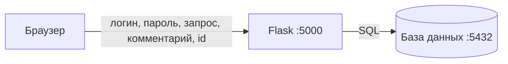

# ЛР1. Знакомство с целью: приложение, атаки вручную, план проверок

**Время:** 2 академических часа.
**Что получится:** рабочее окружение, свой Git-репозиторий с уязвимым приложением, три подтверждённые вручную уязвимости и план, какой сканер что должен найти.

Программировать не нужно. Все команды копируются из методички.

> Приложение намеренно уязвимо. Запускайте его только на своём компьютере. Чужие системы не сканируйте.

## Коротко о главном

- **DevSecOps** — проверки безопасности запускаются автоматически на каждое изменение кода, а не один раз перед релизом.
- **Shift left** («сдвиг влево») — чем раньше найден дефект, тем дешевле его исправить.
- Сканер **находит**, человек **решает**: исправить, принять риск или признать ложным срабатыванием.
- Ни один сканер не находит всё. Поэтому их несколько, и у каждого своя зона.

| Работа | Вид проверки | Инструмент | Что ищет |
|---|---|---|---|
| ЛР2 | SAST — анализ исходного кода | Semgrep | опасные конструкции в коде |
| ЛР3 | Поиск секретов | Gitleaks | пароли и токены в коде и истории Git |
| ЛР4 | SCA — анализ зависимостей | Trivy | уязвимые библиотеки, ошибки Dockerfile |
| ЛР5 | DAST — анализ работающего приложения | OWASP ZAP | заголовки, поведение сервера |
| ЛР5 | CI — конвейер | GitHub Actions | запускает всё перечисленное автоматически |

Практикум опирается на ГОСТ Р 56939-2024 (разработка безопасного ПО): моделирование угроз, статический, композиционный и динамический анализ, поиск секретов — это процессы из этого стандарта.

## Что установить

| Программа | Проверка |
|---|---|
| Git | `git --version` |
| Python 3.11+ | `python --version` |
| Docker Desktop (нужен с ЛР3) | `docker run --rm hello-world` |
| Учётная запись github.com (нужна в ЛР5) | — |

Терминал: в Windows — **Git Bash**, в Linux и macOS — обычный.

## Ход работы

### Шаг 1. Создать свой репозиторий

```bash
cd ~
git clone https://github.com/univerdvfu/secure-development-labs.git
cp -r secure-development-labs/vulnerable-app devsecops-lab
cd devsecops-lab

git init -b main
git config user.name "Имя Фамилия"
git config user.email "ваша_почта@example.com"
git add .
git commit -m "Initial vulnerable training app"
git log --oneline
```

Что получилось:

- `~/secure-development-labs` — материалы курса и готовые исправления. Не меняйте эту папку.
- `~/devsecops-lab` — **ваш проект**. Все команды всех работ выполняются в нём.

**Что увидите:** одна строка — ваш первый коммит.

**В отчёт:** вывод `git log --oneline`.

### Шаг 2. Запустить приложение

```bash
python -m venv .venv
source .venv/Scripts/activate     # Windows, Git Bash
# source .venv/bin/activate       # Linux и macOS
python -m pip install -r requirements.txt -r requirements-dev.txt
python -m backend.app
```

**Что увидите:** `Running on http://127.0.0.1:5000`. Терминал не закрывайте. Остановка сервера — `Ctrl+C`.

Откройте <http://127.0.0.1:5000>. Учётные записи: `student / student123`, `admin / admin123`.

Если не получилось:

- `python: command not found` — используйте `python3`.
- Порт 5000 занят (в macOS его занимает AirPlay) — отключите «Приёмник AirPlay» в настройках.

> Окружение `.venv` нужно активировать в каждом новом окне терминала — той же командой `source …`.

**В отчёт:** снимок экрана главной страницы.

### Шаг 3. Три атаки вручную

Прежде чем запускать сканеры, убедитесь своими руками, что уязвимости настоящие. Позже вы сверите: что из этого сканеры нашли, а что нет.

**Атака 1. Вход без пароля (SQL-инъекция).** Откройте `/login`. Логин: `admin' -- ` (после двух дефисов пробел), пароль любой.

**Что увидите:** вы вошли как `admin`.

Почему: логин вставляется прямо в текст SQL-запроса. Кавычка закрывает строку, `--` превращает проверку пароля в комментарий.

**Атака 2. Внедрение разметки (XSS).** Выйдите из системы. Откройте `/comments` и отправьте комментарий:

```text
<b>жирный</b> 
```

**Что увидите:** всплывающее окно. Оно будет появляться у каждого, кто откроет страницу: сценарий сохранён в базе.

Почему: текст пользователя выводится как HTML-разметка, а не как текст.

**Атака 3. Чужой профиль (IDOR).** Не входя в систему, откройте `/profile?id=1`, затем `/profile?id=3`.

**Что увидите:** почту и «закрытую заметку» администратора и другого студента.

Почему: сервер показывает профиль по номеру из адреса и не проверяет, кто спрашивает.

**В отчёт:** по одному снимку экрана на каждую атаку.

### Шаг 4. Осмотреть проект

Откройте каталог проекта в редакторе. Писать код не нужно — нужно знать, где что лежит: сканеры будут ссылаться на эти файлы.

| Файл | Что в нём | Что найти |
|---|---|---|
| `backend/app.py` | логика сайта | последнюю строку: `debug=True` |
| `backend/config.py` | настройки | строку с `DEMO_GITHUB_TOKEN` |
| `frontend/templates/*.html` | страницы | слово `safe` в `search.html` и `comments.html` |
| `requirements.txt` | список библиотек | — |
| `legacy-component/requirements.txt` | старый список библиотек | — |
| `Dockerfile`, `compose.yaml` | запуск в контейнере | порты в `compose.yaml` |

Схема приложения:



Всё, что приходит из браузера, — недоверенные данные.

### Шаг 5. Составить план проверок

Заполните таблицу. Это ваша гипотеза: в ЛР5 вы проверите, сбылась ли она.

| № | Проблема | Где | Как вы о ней узнали | Какой сканер должен найти (SAST / секреты / SCA / DAST / никакой) |
|---|---|---|---|---|
| 1 | SQL-инъекция | `/login` | атака 1 | |
| 2 | XSS | `/comments`, `/search` | атака 2 | |
| 3 | Чужой профиль без входа | `/profile?id=` | атака 3 | |
| 4 | Отладочный режим | `app.py` | шаг 4 | |
| 5 | Токен в коде | `config.py` | шаг 4 | |
| 6 | Старые библиотеки | `legacy-component` | шаг 4 | |
| 7 | Открыт порт базы данных | `compose.yaml` | шаг 4 | |
| 8 | Пароли хранятся открытым текстом | база данных | вход `student123` | |

**В отчёт:** заполненная таблица.

### Шаг 6. Завершить

Остановите сервер (`Ctrl+C`) и проверьте, что ничего не изменено:

```bash
git status
```

**Что увидите:** `nothing to commit, working tree clean`.

## Отчёт

Оформляется по [шаблону](report-template.md):

1. Вывод `git log --oneline`.
2. Снимок экрана работающего приложения.
3. Три снимка экрана атак.
4. Таблица плана проверок.
5. Ответы на контрольные вопросы.

## Контрольные вопросы

1. Что означает «сдвиг влево»?
2. Почему проверку прав нельзя доверять браузеру?
3. Какую из восьми проблем, по вашему мнению, не найдёт ни один сканер? Почему?
4. Чем SAST отличается от DAST?

## Оценивание

| Критерий | Баллы |
|---|---|
| Репозиторий создан, приложение запущено | 25 |
| Три атаки подтверждены | 35 |
| План проверок | 25 |
| Контрольные вопросы | 15 |
| **Итого** | **100** |
