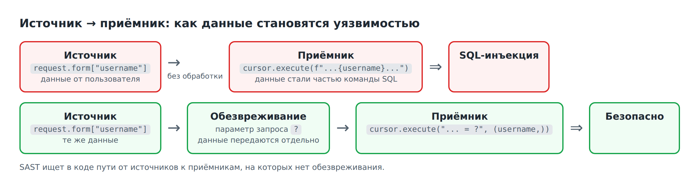
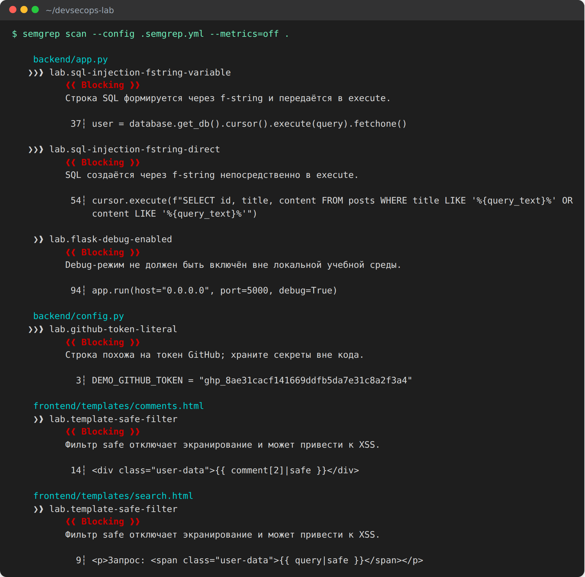
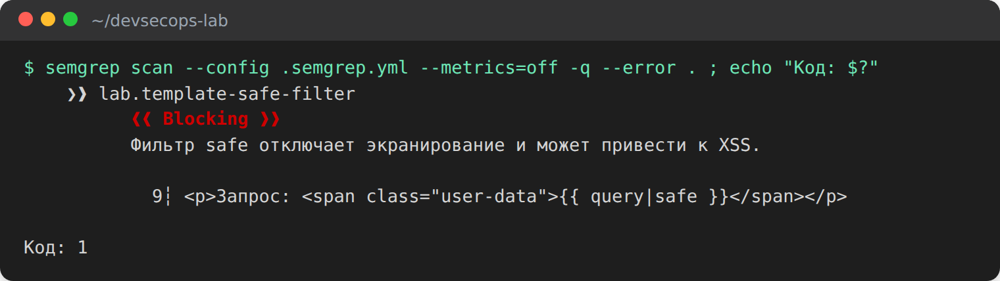
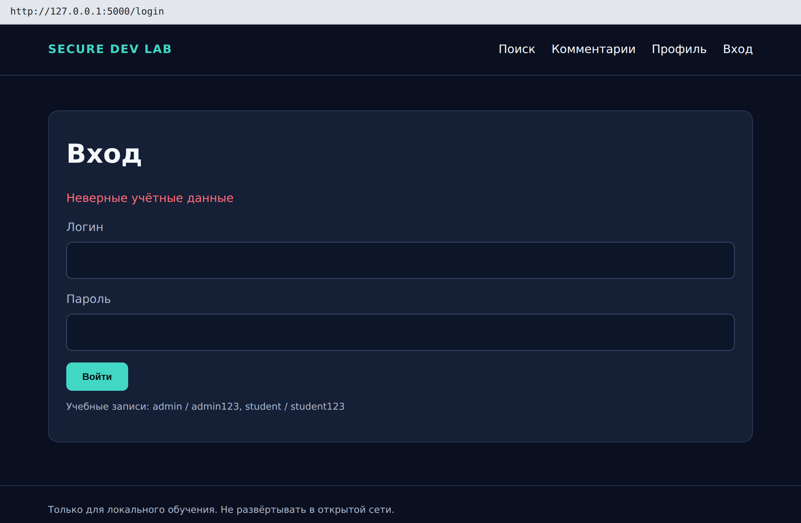
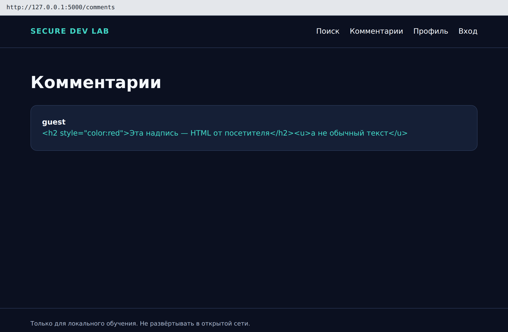

# Лабораторная работа №2. SAST: статический анализ кода с Semgrep

**Время:** 2 академических часа.

**Что получится:** вы запустите Semgrep с двумя наборами правил, научитесь читать находку, отсеете ложные срабатывания, настроите вывод и код завершения, примените готовое исправление и убедитесь сканером, что оно сработало.

Код писать не нужно: исправления уже подготовлены.

**Перед началом:** выполнена ЛР1.

---

## 1. Цель работы

Освоить работу со статическим анализатором: от первого запуска до команды, пригодной для конвейера.

После работы вы сможете:

- объяснить, как статический анализатор находит уязвимости и почему он ошибается;
- прочитать правило Semgrep и находку;
- отличить настоящую находку от ложного срабатывания и обосновать решение;
- управлять сканером: набор правил, важность, формат отчёта, код завершения;
- подтвердить устранение уязвимости повторным сканированием.

## 2. Теория

### 2.1. Что такое SAST

**SAST** (Static Application Security Testing) — анализ исходного кода **без его запуска**. Анализатор читает файлы так же, как их читает человек на код-ревью, только быстрее и не устаёт.

| Сильные стороны | Ограничения |
|---|---|
| приложение не нужно собирать и запускать | не видит ошибок логики: кому что разрешено |
| указывает точный файл и строку | даёт ложные срабатывания |
| работает секунды, годится для каждого изменения | находит только то, на что есть правила |
| проверяет весь код, включая редко работающие ветки | не знает, с какими настройками приложение запустят |

### 2.2. Как анализатор находит уязвимость

Большинство уязвимостей веб-приложений устроены одинаково: недоверенные данные доходят до опасной операции без обработки. Для описания этого пути используют три термина.

- **Источник (source)** — место, где в программу попадают данные от пользователя: поля формы, параметры адресной строки.
- **Приёмник (sink)** — операция, для которой содержимое данных критично: выполнение SQL-запроса, вставка в HTML-страницу, запуск команды.
- **Обезвреживание (sanitizer)** — обработка, после которой данные для приёмника безопасны.



Задача анализатора — найти пути от источников к приёмникам, на которых нет обезвреживания. Задача аналитика — проверить каждую такую находку: действительно ли данные приходят от пользователя и действительно ли их ничто не обезвреживает.

В атаке 1 из прошлой работы источником были поля формы входа, приёмником — выполнение SQL-запроса. В атаке 2 источник — текст комментария, приёмник — HTML-страница.

### 2.3. Правила

Сам по себе анализатор ничего не «знает» об уязвимостях. Он ищет то, что описано в **правилах**. Нет правила — нет находки.

Правило Semgrep — это шаблон кода. Вот одно из правил нашего проекта (файл `.semgrep.yml`):

```yaml
- id: lab.sql-injection-fstring-direct
  languages: [python]
  severity: ERROR
  message: SQL создаётся через f-string непосредственно в execute.
  pattern: $CURSOR.execute(f"...")
```

| Поле | Смысл |
|---|---|
| `id` | имя правила; по нему находку ищут, обсуждают и подавляют |
| `languages` | к каким файлам применять |
| `severity` | важность: `ERROR`, `WARNING`, `INFO` |
| `message` | пояснение для человека |
| `pattern` | что искать: `$CURSOR` — «любое выражение», `f"..."` — «любая строка с подстановками» |

Правило читается так: «найди любой вызов `что-угодно.execute(...)`, которому передана строка с подстановками». Semgrep сравнивает структуру кода, а не текст, поэтому пробелы и переносы строк на результат не влияют.

Правила объединяют в **наборы (rulesets)**. Набор можно написать самому — как `.semgrep.yml` — или взять готовый из реестра Semgrep, например `p/default`. В этой работе вы сравните оба подхода.

### 2.4. Ошибки анализатора

Анализатор ошибается в обе стороны.

| | Проблема есть | Проблемы нет |
|---|---|---|
| **Сканер сообщил** | верная находка | **ложное срабатывание** (false positive, FP) |
| **Сканер промолчал** | **пропуск** (false negative, FN) | верно |

**Ложные срабатывания** возникают, когда код похож на опасный шаблон, но безопасен. Они отнимают время и — что хуже — приучают игнорировать отчёт.

**Пропуски** возникают, когда уязвимость есть, а подходящего правила нет или код написан необычно. Они опаснее, потому что незаметны.

Отсюда два вывода, которые нужно запомнить:

> Пустой отчёт означает «по этим правилам ничего не найдено», а не «код безопасен».
>
> Каждая находка требует разбора человеком.

### 2.5. Разбор находок

Разбор (triage) — это принятие решения по каждой находке. Вариантов три:

| Решение | Когда | Что делать |
|---|---|---|
| **Исправить** | находка настоящая | передать разработчику, после исправления перепроверить |
| **Подавить** | ложное срабатывание | отключить правило или строку, **письменно обосновать** |
| **Принять риск** | настоящая, но исправление нецелесообразно | зафиксировать решение, ответственного и срок пересмотра |

Подавление — не способ «сделать отчёт зелёным». Правила подавления:

- подавляют конкретное правило или строку, а не «всё, что мешает»;
- у каждого подавления есть обоснование и автор;
- настоящую уязвимость не подавляют.

**ГОСТ Р 71207-2024** требует от статического анализа воспроизводимости и учёта: фиксируются версия анализатора, набор правил, объект проверки и решение по каждому срабатыванию. В отчёте вы делаете то же самое в учебном масштабе.

### 2.6. Код завершения — язык, на котором сканер говорит с конвейером

Каждая программа в терминале, завершаясь, возвращает число — **код завершения**. Ноль означает «успех», любое другое — «ошибка». Человек его обычно не видит, а конвейер смотрит только на него.

Поэтому для автоматизации важно не то, что сканер напечатал, а то, какой код он вернул. Сканер, который нашёл десять уязвимостей и вернул 0, для конвейера равен сканеру, который ничего не нашёл. Умение заставить сканер вернуть нужный код — центральный навык всего практикума.

## 3. Ход работы

Каталог проекта и окружение:

```bash
cd ~/devsecops-lab
source .venv/Scripts/activate     # Windows, Git Bash
# source .venv/bin/activate       # Linux и macOS
mkdir -p reports
```

Папка `reports` — для отчётов сканеров. В Git она не попадает (указана в `.gitignore`).

### Шаг 1. Первый запуск

```bash
semgrep --version
semgrep scan --config .semgrep.yml --metrics=off .
```

| Параметр | Смысл |
|---|---|
| `scan` | режим сканирования |
| `--config .semgrep.yml` | взять правила из файла проекта (пять учебных правил) |
| `--metrics=off` | не отправлять статистику разработчику сканера |
| `.` | проверять текущий каталог |



**Что увидите:** в конце вывода `Ran 5 rules on … files: 6 findings.`

| Правило | Файл | Строка |
|---|---|---|
| `lab.sql-injection-fstring-variable` | `backend/app.py` | 37 |
| `lab.sql-injection-fstring-direct` | `backend/app.py` | 54 |
| `lab.flask-debug-enabled` | `backend/app.py` | 94 |
| `lab.github-token-literal` | `backend/config.py` | 3 |
| `lab.template-safe-filter` | `frontend/templates/comments.html` | 14 |
| `lab.template-safe-filter` | `frontend/templates/search.html` | 9 |

Если не получилось:

- `semgrep: command not found` — не активировано окружение `.venv`;
- ошибка про `semgrep-core` — установлена старая версия: выполните `python -m pip install -r requirements-dev.txt`.

**В отчёт:** версия Semgrep и итоговая строка.

### Шаг 2. Научиться читать находку

Рассмотрите одну находку из вывода:

```text
    backend/app.py
   ❯❯❱ lab.sql-injection-fstring-variable
          ❰❰ Blocking ❱❱
          Строка SQL формируется через f-string и передаётся в execute.

           37┆ user = database.get_db().cursor().execute(query).fetchone()
```

| Элемент | Что означает |
|---|---|
| `backend/app.py` | файл |
| `❯❯❱` | важность: три стрелки — ERROR, две — WARNING |
| `lab.sql-injection-fstring-variable` | идентификатор правила |
| `Blocking` | находка считается блокирующей для конвейера |
| текст | сообщение из правила |
| `37┆ …` | номер строки и сама строка кода |

Откройте `backend/app.py` на строках 36–37. Найдите источник (откуда берутся `username` и `password` — двумя строками выше) и приёмник (`execute`).

Теперь заполните таблицу по всем шести находкам. Сопоставьте их с атаками из ЛР1.

| № | Правило | Файл:строка | Соответствует атаке из ЛР1 | Настоящая или ложная | Важность |
|---|---|---|---|---|---|
| 1 | `sql-injection-fstring-variable` | `app.py:37` | атака 1, вход без пароля | настоящая | ERROR |
| 2 | | | | | |
| … | | | | | |

Вопрос: атаку 3 (чужой профиль) Semgrep не нашёл. Почему? Вспомните раздел 2.6 первой работы.

**В отчёт:** таблица и ответ.

### Шаг 3. Запустить готовый набор правил

Пять своих правил — это мало. Запустите стандартный набор из реестра Semgrep:

```bash
semgrep scan --config p/default --metrics=off .
```

Нужен интернет: правила скачиваются из реестра. В выводе будет строка вроде `Ran 498 rules` — сравните с пятью.

**Что увидите:** около 18 находок. Точное число зависит от даты: правила в реестре обновляются.

Сравните два запуска. Для каждой строки найдите в выводе `p/default` соответствующее правило или убедитесь, что его нет.

| Проблема | Свои правила | `p/default` |
|---|---|---|
| SQL-инъекция в `/login` и `/search` | найдено | |
| XSS через `safe` в шаблонах | найдено | |
| Отладочный режим | найдено | |
| Токен в `config.py` | найдено | |
| Сервер слушает на всех адресах (`0.0.0.0`) | — | |
| Контейнер работает от root (`Dockerfile`) | — | |
| Нет защиты форм от CSRF | — | |

Ответьте на три вопроса:

1. Что нашёл только готовый набор?
2. Что готовый набор **пропустил**, хотя уязвимость настоящая и вы её эксплуатировали в ЛР1?
3. Строка `app.py:54` попала в отчёт несколько раз под разными правилами. Это несколько уязвимостей или одна?

**В отчёт:** таблица и три ответа.

### Шаг 4. Найти ложное срабатывание

В отчёте `p/default` есть правило `sqlalchemy-execute-raw-query` на строках `app.py:65` и `app.py:78`. Откройте строку 65:

```python
connection.cursor().execute(
    f"INSERT INTO comments (author, content) VALUES ({mark}, {mark})",
    (author, content),
)
```

Сравните со строкой 36, где находка настоящая:

```python
query = f"SELECT … WHERE username = '{username}' AND password = '{password}'"
```

| | Строка 36 | Строка 65 |
|---|---|---|
| Что подставляется в текст запроса | `username`, `password` — данные пользователя | `mark` — знак параметра (`?`), задаётся программой |
| Как передаются данные пользователя | внутри текста запроса | отдельно, вторым аргументом `(author, content)` |
| Может ли пользователь изменить команду SQL | да | нет |

На строке 65 используется правильный приём — параметризованный запрос. Правило сработало потому, что увидело строку с подстановкой внутри `execute`, и не разобралось, что подставляется. Вдобавок оно написано для библиотеки SQLAlchemy, которой в проекте нет.

Это **ложное срабатывание**.

**В отчёт:** своими словами — почему строка 65 безопасна, а строка 36 нет.

### Шаг 5. Управлять выводом сканера

**Фильтр по важности.** Показать только находки уровня ERROR:

```bash
semgrep scan --config .semgrep.yml --metrics=off --severity ERROR .
```

**Что увидите:** `3 findings` вместо шести.

**Отчёты в файл.** JSON удобен для обработки программами, SARIF — стандартный формат, который понимают GitHub и системы управления уязвимостями:

```bash
semgrep scan --config .semgrep.yml --metrics=off --json-output reports/sast-before.json --sarif-output reports/sast-before.sarif .
ls reports
```

Откройте `reports/sast-before.json` в редакторе и найдите поля `check_id`, `path`, `start.line` — те же сведения, что на экране, в машинном виде.

**Код завершения.** Выполните две команды:

```bash
semgrep scan --config .semgrep.yml --metrics=off -q . ; echo "Код: $?"
semgrep scan --config .semgrep.yml --metrics=off -q --error . ; echo "Код: $?"
```

`$?` — код завершения предыдущей команды; `-q` — краткий вывод.

**Что увидите:** первая команда — `Код: 0`, вторая — `Код: 1`.



Без `--error` Semgrep нашёл шесть уязвимостей и сообщил конвейеру «всё в порядке». С `--error` любая находка даёт код 1. Запомните этот параметр: без него сканер в конвейере бесполезен.

**В отчёт:** число находок с фильтром, оба кода завершения и объяснение разницы.

### Шаг 6. Применить готовое исправление

Исправленные файлы лежат в материалах курса. Скопируйте их поверх своих:

```bash
cp -r ../secure-development-labs/solutions/lab2/. .
git status --short
```

**Что увидите:** четыре изменённых файла.

```text
 M backend/app.py
 M frontend/templates/comments.html
 M frontend/templates/search.html
 M tests/test_app.py
```

Посмотрите, что изменилось:

```bash
git diff backend/app.py
```

Строки с минусом удалены, с плюсом — добавлены. Специалисту по безопасности не обязательно писать такой код, но нужно уметь прочитать изменение и понять, устранена ли **причина**.

| Было | Стало | Почему это защита |
|---|---|---|
| данные пользователя вклеивались в текст SQL | текст запроса и данные передаются раздельно | база не может принять данные за команду |
| `{{ query\|safe }}` в шаблонах | `{{ query }}` | текст выводится как текст, теги не исполняются |
| `debug=True` | `debug=False` | отключена отладочная консоль |

Сравните новый код функции `login` со строкой 65 из шага 4 — приём тот же самый.

**В отчёт:** вывод `git status --short`.

### Шаг 7. Проверить исправление тремя способами

Одной проверки мало: сканер мог перестать видеть шаблон, а уязвимость остаться.

**Способ 1. Автоматические тесты.** Вместе с исправлением пришли тесты, которые повторяют атаки и проверяют, что они не проходят:

```bash
pytest -q
```

**Что увидите:** `7 passed`.

**Способ 2. Сканер.**

```bash
semgrep scan --config .semgrep.yml --metrics=off --json-output reports/sast-after.json .
```

**Что увидите:** `1 finding` — остался только токен в `config.py`. Им займётесь в ЛР3.

**Способ 3. Вручную.** Запустите приложение (`python -m backend.app`) и повторите атаки 1 и 2 из ЛР1.





**Что увидите:** вход с `admin' -- ` даёт «Неверные учётные данные»; комментарий с тегами отображается как текст.

Остановите сервер (`Ctrl+C`).

**В отчёт:** вывод `pytest`, итог Semgrep, снимки экрана неудавшихся атак.

### Шаг 8. Подавить ложное срабатывание

Запустите готовый набор ещё раз:

```bash
semgrep scan --config p/default --metrics=off .
```

**Что увидите:** около 8 находок вместо 18. Четыре из них — ложное срабатывание `sqlalchemy-execute-raw-query`: исправленный код использует параметры, но правило этого не понимает.

Если ложные срабатывания оставить, отчёт всегда будет «красным», и на него перестанут смотреть. Отключите это правило:

```bash
semgrep scan --config p/default --metrics=off --exclude-rule python.sqlalchemy.security.sqlalchemy-execute-raw-query.sqlalchemy-execute-raw-query .
```

**Что увидите:** около 4 находок. Разберите оставшиеся:

| Правило | Настоящая? | Что с ней делать |
|---|---|---|
| `missing-user` (Dockerfile) | | исправляется в ЛР4 |
| `avoid_app_run_with_bad_host` | | |
| `django-no-csrf-token` (2 шт.) | | |

Запишите обоснование подавления так, как оно должно выглядеть в рабочих документах:

> Правило `sqlalchemy-execute-raw-query` отключено для проекта. Причина: … Проверено на строках … Автор: …, дата: …

Есть и второй способ — подавить одну строку комментарием в коде: `# nosemgrep: идентификатор-правила`. Он точнее, но требует правки кода.

**В отчёт:** числа 18 → 8 → 4, таблица, обоснование.

### Шаг 9. Собрать команду для конвейера

Соберите всё изученное в одну команду — именно она будет работать в конвейере в ЛР5:

```bash
semgrep scan --config .semgrep.yml --metrics=off --error --json-output reports/semgrep.json .
echo "Код: $?"
```

**Что увидите:** `Код: 1` — из-за оставшегося токена. После ЛР3 код станет 0.

В файле конвейера это будет выглядеть так:

```yaml
- name: Run Semgrep
  run: semgrep scan --config .semgrep.yml --metrics=off --error --json-output reports/semgrep.json .
```

| Свойство команды | Чем обеспечено |
|---|---|
| останавливает конвейер при находке | `--error` |
| оставляет отчёт для разбора | `--json-output` |
| даёт одинаковый результат сегодня и через месяц | точная версия Semgrep в `requirements-dev.txt`, свои правила в репозитории |
| не шумит ложными срабатываниями | набор правил проверен на проекте |

Вопрос для отчёта: почему в конвейер поставлены свои правила, а не `p/default`? Подсказка: вспомните шаг 8 и то, что правила в реестре меняются без вашего ведома.

### Шаг 10. Сохранить результат

```bash
git add -A
git commit -m "lab2: fix SQL injection, XSS and debug mode"
git log --oneline
```

**Что увидите:** два коммита.

## 4. Требования к отчёту

1. Версия Semgrep, итог первого запуска.
2. Таблица шести находок, ответ про атаку 3.
3. Сравнение своих правил и `p/default`, три ответа.
4. Разбор ложного срабатывания.
5. Фильтр по важности, коды завершения с объяснением.
6. Результаты трёх проверок после исправления.
7. Числа 18 → 8 → 4, таблица остатка, обоснование подавления.
8. Ответ на вопрос шага 9.
9. Ответы на контрольные вопросы.

## 5. Контрольные вопросы

1. Что такое источник, приёмник и обезвреживание? Приведите пример из приложения.
2. Чем ложное срабатывание отличается от пропуска? Приведите по примеру из этой работы.
3. Сканер показал 0 находок. Что из этого следует, а что нет?
4. Какие три решения можно принять по находке?
5. Когда находку можно подавить, а когда нельзя?
6. Что такое код завершения и зачем нужен параметр `--error`?
7. Почему одного набора правил недостаточно?

## 6. Критерии оценивания

| Критерий | Баллы |
|---|---|
| Запуск и разбор шести находок | 20 |
| Сравнение наборов правил | 15 |
| Ложное срабатывание: найдено, объяснено, подавлено с обоснованием | 20 |
| Управление выводом и кодом завершения | 15 |
| Проверка исправления тремя способами | 15 |
| Контрольные вопросы | 15 |
| **Итого** | **100** |

## 7. Источники

- ГОСТ Р 71207-2024. Статический анализ программного обеспечения. Общие требования.
- Документация Semgrep: <https://semgrep.dev/docs/>
- Реестр правил Semgrep: <https://semgrep.dev/explore>
- OWASP SQL Injection Prevention Cheat Sheet: <https://cheatsheetseries.owasp.org/cheatsheets/SQL_Injection_Prevention_Cheat_Sheet.html>
- OWASP Cross Site Scripting Prevention Cheat Sheet: <https://cheatsheetseries.owasp.org/cheatsheets/Cross_Site_Scripting_Prevention_Cheat_Sheet.html>
