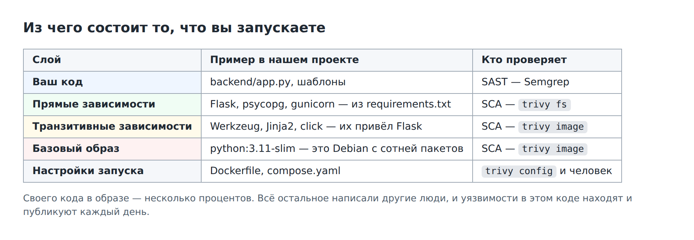
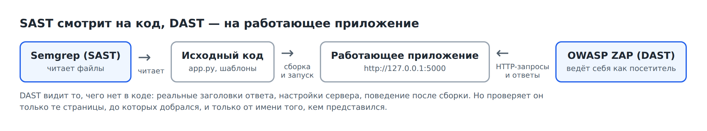
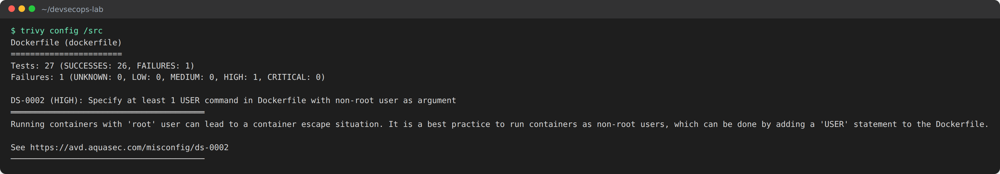
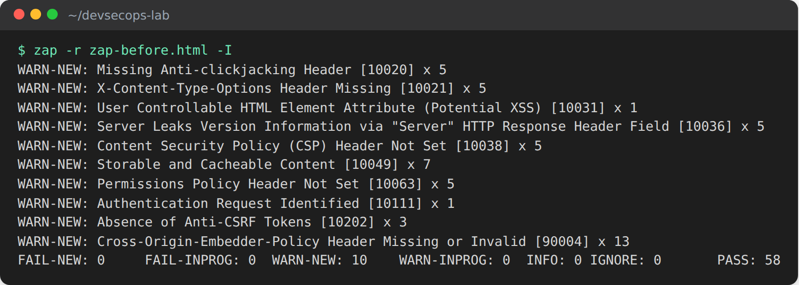
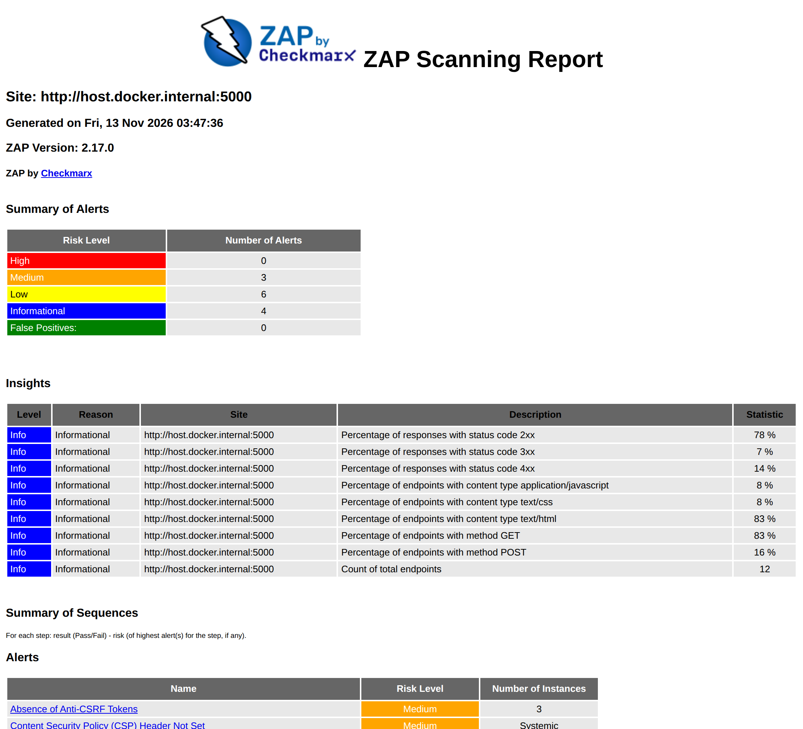
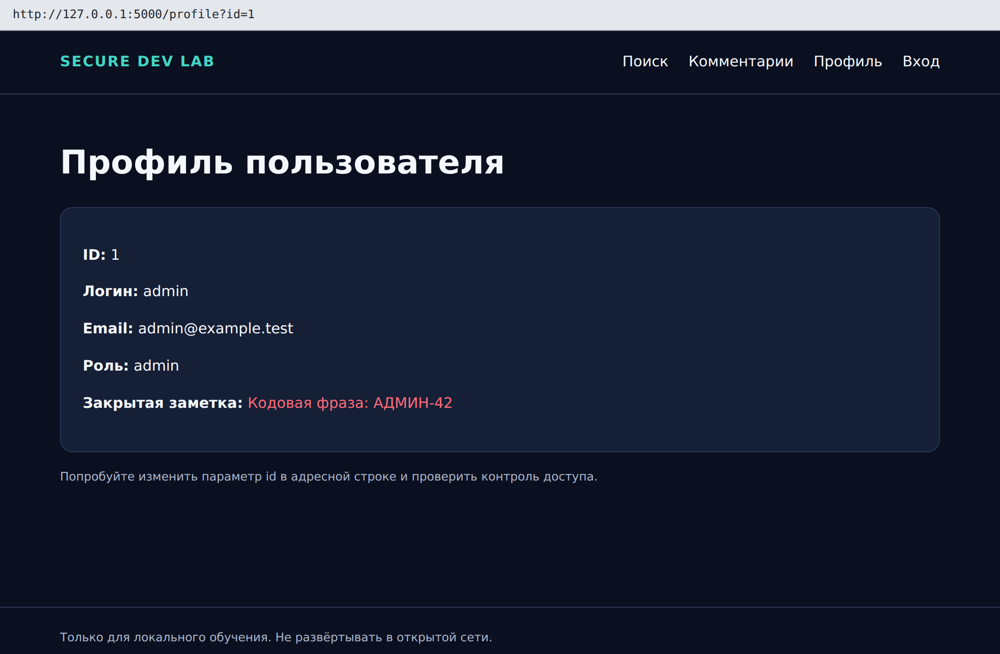
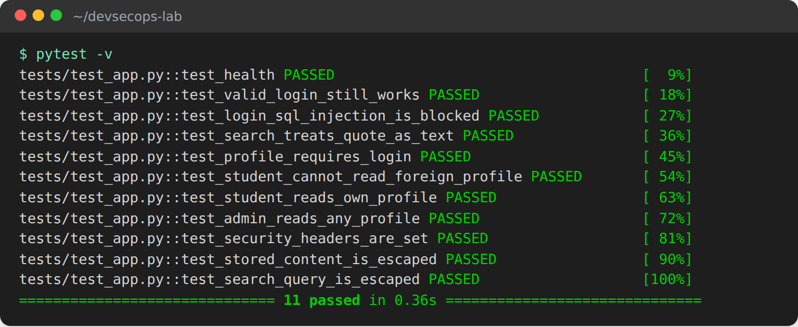
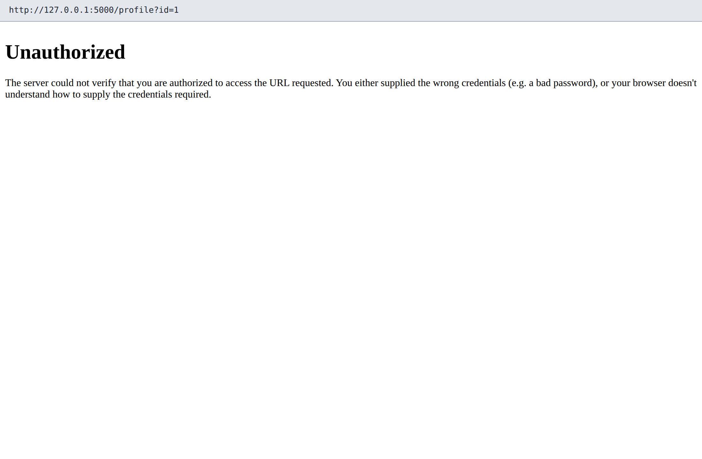

# Лабораторная работа №4. То, что запускается: контейнер и DAST

**Время:** 4 академических часа (два занятия): часть А — контейнер и Trivy, часть Б — работающее приложение и OWASP ZAP.

**Что получится:** вы проверите Dockerfile и собранный образ, разберётесь с уязвимостями базового образа, затем просканируете работающее приложение, найдёте дефект, которого не видит ни один сканер, и настроите файл правил ZAP с порогом для конвейера.

Код писать не нужно: исправления подготовлены.

**Перед началом:** выполнена ЛР3, запущен Docker.

---

## 1. Цель работы

В ЛР2 и ЛР3 сканеры смотрели на файлы в репозитории. Но в эксплуатацию уходит не репозиторий, а **собранный образ**, и работает не код, а **запущенное приложение**. Цель работы — научиться проверять и то и другое.

После работы вы сможете:

- назвать типовые ошибки конфигурации контейнера и найти их сканером;
- просканировать образ и объяснить, откуда в нём уязвимости, которых нет в вашем коде;
- выбрать разумный порог для уязвимостей без исправления;
- объяснить, чем DAST дополняет SAST и SCA;
- провести пассивное сканирование ZAP, прочитать отчёт и оценить покрытие;
- превратить решения по находкам в файл правил с порогом.

## 2. Теория

### 2.1. Контейнер и образ

**Образ** — упакованное приложение со всем, что нужно для запуска: операционной системой, библиотеками, кодом. **Контейнер** — запущенный экземпляр образа.

**Dockerfile** — рецепт сборки образа. Прочитайте рецепт нашего приложения:

```dockerfile
FROM python:3.11-slim
WORKDIR /app
COPY requirements.txt .
RUN pip install --no-cache-dir -r requirements.txt
COPY backend ./backend
COPY frontend ./frontend
CMD ["python", "-m", "backend.app"]
```

| Инструкция | Смысл |
|---|---|
| `FROM` | взять за основу готовый образ — здесь Debian с Python 3.11 |
| `COPY` | скопировать файлы проекта внутрь образа |
| `RUN` | выполнить команду при сборке — здесь установить библиотеки |
| `USER` | от имени какого пользователя работать (в исходном файле отсутствует) |
| `CMD` | что запускать при старте контейнера |

**compose.yaml** описывает, как запустить несколько контейнеров вместе: у нас это приложение (`web`) и база данных (`db`).

### 2.2. Типовые ошибки конфигурации

Контейнер изолирует приложение от остальной системы, но изоляция не абсолютна.

| Ошибка | Чем опасна | Как исправляют |
|---|---|---|
| процесс работает от `root` | при взломе приложения нарушитель получает максимальные права в контейнере, а при ошибке изоляции — и на сервере | инструкция `USER` с обычным пользователем |
| наружу открыты лишние порты | база данных доступна из сети в обход приложения | публиковать только порт приложения |
| версия образа не указана (`latest`) | сегодня и завтра собираются разные образы | указывать версию |
| в образ попадают лишние файлы | утечка секретов, лишние уязвимости | `.dockerignore` |
| секреты в инструкциях `ENV`, `ARG` | остаются в слоях образа навсегда | передавать при запуске |

### 2.3. Откуда в образе уязвимости

Вернитесь к схеме слоёв из ЛР3:



`trivy fs` в ЛР3 видел только второй слой — то, что записано в `requirements.txt`. Но в образе есть ещё транзитивные зависимости и целая операционная система из базового образа: сотня пакетов, которые вы не выбирали.

Поэтому чистый отчёт по `requirements.txt` не означает чистого образа. То, что реально запускается, проверяет только `trivy image`.

У многих уязвимостей в пакетах операционной системы **нет исправления**: проблема известна, но обновлённый пакет ещё не выпущен (статус `affected`). Обновлять нечего. Требование «ноль HIGH-уязвимостей в образе» поэтому невыполнимо, и порог для образа выбирают иначе: блокируют только те уязвимости, которые **можно** исправить (`--ignore-unfixed`).

### 2.4. Что такое DAST

**DAST** (Dynamic Application Security Testing) — проверка **работающего** приложения снаружи. Сканер ведёт себя как очень настойчивый посетитель: открывает страницы, переходит по ссылкам, изучает ответы сервера. Исходный код ему не нужен.



| | SAST (ЛР2) | SCA (ЛР3, ЛР4-А) | DAST (ЛР4-Б) |
|---|---|---|---|
| Что проверяет | исходный код | версии компонентов | работающее приложение |
| Нужно ли запускать приложение | нет | нет | да |
| Что видит только он | опасные конструкции в коде | известные уязвимые версии | заголовки ответа, настройки сервера, реальное поведение |
| Чего не видит | настройки запуска, права доступа | ваши собственные ошибки | код; страницы, до которых не дошёл |

Методы дополняют друг друга. Заголовки ответа сервера видит только DAST. Неиспользуемую уязвимую библиотеку — только SCA. Опасную функцию в редко работающей ветке кода — только SAST.

### 2.5. Пассивное и активное сканирование

| | Пассивное (baseline) | Активное (full scan) |
|---|---|---|
| Что делает | обходит сайт по ссылкам и анализирует ответы | подставляет в параметры вредоносные значения |
| Меняет ли данные | нет | да: может создавать и портить записи |
| Время | 1–2 минуты | десятки минут |
| Где применяют | в конвейере на каждое изменение | на выделенном стенде, по расписанию |

> Активное сканирование чужой системы без письменного разрешения владельца — правонарушение. В практикуме сканируется только приложение на вашем компьютере, и только в пассивном режиме.

### 2.6. Как читать результат ZAP

ZAP делит результаты проверок на три группы: `PASS` — проверка пройдена, `WARN` — предупреждение, `FAIL` — провал. По умолчанию все находки пассивного сканирования — предупреждения. Какие из них считать провалом, решаете вы в **файле правил**.

Два обязательных замечания:

- `WARN` — повод для разбора, а не доказательство уязвимости;
- `FAIL: 0` не означает «безопасно».

Второе важнее. Сканер проверил только те страницы, до которых добрался по ссылкам, и только от имени анонимного посетителя. Всё, что находится за формой входа, он не видел. Это называют **покрытием**, и оценивать его — обязанность аналитика.

### 2.7. Заголовки безопасности

Сервер может дать браузеру инструкции, ограничивающие последствия атак. Их отсутствие — основное, что находит пассивное сканирование.

| Заголовок | Что делает | От чего защищает |
|---|---|---|
| `Content-Security-Policy` | перечисляет, откуда странице разрешено загружать сценарии и стили | XSS |
| `X-Content-Type-Options: nosniff` | запрещает браузеру угадывать тип файла | подмена типа содержимого |
| `X-Frame-Options: DENY` | запрещает показывать сайт во фрейме на чужой странице | кликджекинг |
| `Permissions-Policy` | отключает доступ к камере, микрофону, геолокации | злоупотребление функциями браузера |

Заголовки — дополнительный рубеж. Они не заменяют исправление самой уязвимости.

### 2.8. Чего не видит ни один сканер

Вспомните атаку 3 из ЛР1: профиль администратора открывается любому, кто поменяет число в адресе. Сканер не знает, что профиль номер 1 «чужой». Технически запрос корректен и ответ корректен. Нарушено **бизнес-правило** — «кому что можно видеть», — а оно существует только в головах людей и в требованиях.

Такие дефекты (нарушения контроля доступа — первая строка рейтинга OWASP Top 10) находят вручную. А чтобы находка не вернулась, её закрепляют **автоматическим тестом**: тест — это способ объяснить конвейеру правило, которого не знает сканер.

Правильное поведение сервера:

| Ситуация | Код ответа | Смысл |
|---|---|---|
| запрос без входа в систему | **401** | «представьтесь» |
| запрос чужого объекта | **403** | «вам нельзя» |
| запрос своего объекта | **200** | данные выданы |

---

## 3. Ход работы

```bash
cd ~/devsecops-lab
source .venv/Scripts/activate     # Windows, Git Bash
# source .venv/bin/activate       # Linux и macOS
mkdir -p reports
export MSYS_NO_PATHCONV=1         # только Windows, Git Bash
```

Сокращение для Trivy — то же, что в ЛР3:

```bash
trivy() { docker run --rm -v "$PWD:/src" -v trivy-cache:/root/.cache/trivy -v /var/run/docker.sock:/var/run/docker.sock aquasec/trivy:0.76.2 "$@"; }
```

Часть `-v /var/run/docker.sock:…` даёт сканеру доступ к образам на вашем компьютере.

# Часть А. Контейнер

### Шаг А1. Проверить Dockerfile

```bash
trivy config /src
```

`config` — режим проверки конфигурационных файлов.



**Что увидите:** `Tests: 27 (SUCCESSES: 26, FAILURES: 1)` и находку **DS-0002 (HIGH)** — в Dockerfile нет инструкции `USER`.

Разберите находку:

| Элемент | Что означает |
|---|---|
| `Tests: 27` | сколько проверок выполнено для файла |
| `DS-0002` | идентификатор правила; по нему можно найти описание |
| `HIGH` | важность |
| текст | что не так и чем это грозит |
| ссылка `avd.aquasec.com/…` | подробное описание и способ исправления |

**В отчёт:** идентификатор, важность и суть находки своими словами.

### Шаг А2. Убедиться на деле

Соберите образ и посмотрите, от чьего имени он работает:

```bash
docker build -t devsecops-lab:local .
docker run --rm devsecops-lab:local id
```

**Что увидите:** `uid=0(root) gid=0(root)`. Сканер не ошибся.

Теперь то, чего сканер **не показал**. Откройте `compose.yaml` и найдите раздел `ports` у сервиса `db`:

```yaml
  db:
    image: postgres:16
    ports:
      - "5432:5432"
```

Эта запись открывает порт базы данных на вашем компьютере для всей сети. Нужно ли это приложению? Нет: сервисы `web` и `db` общаются внутри собственной сети Compose. Пароль базы при этом — `student123`.

Trivy об этом молчит: файлы Compose он не проверяет. Эту проблему вы нашли глазами ещё в ЛР1.

**В отчёт:** вывод `id`; объяснение, чем опасен открытый порт базы и почему сканер его не нашёл.

### Шаг А3. Просканировать образ

```bash
trivy image --severity HIGH,CRITICAL devsecops-lab:local
```

**Что увидите:** длинную таблицу. В контрольном запуске — `Total: 49 (HIGH: 49, CRITICAL: 0)` в пакетах Debian и ещё несколько в служебных пакетах Python.

В ЛР3 порог по `requirements.txt` был пройден. Откуда 49 находок? Из базового образа `python:3.11-slim`: в нём целая операционная система.

Посмотрите на колонку **Status**. У большинства строк там `affected` и пустая колонка Fixed Version: исправления нет.

Запишите свои числа: у вас их будет больше контрольных.

**В отчёт:** итоговые строки `Total`.

### Шаг А4. Отделить то, что можно исправить

```bash
trivy image --severity HIGH,CRITICAL --ignore-unfixed devsecops-lab:local
```

`--ignore-unfixed` — не показывать уязвимости, для которых нет исправления.

**Что увидите:** единицы вместо десятков (в контрольном запуске — 2).

Ответьте письменно:

1. Сколько HIGH и CRITICAL всего и сколько из них можно исправить обновлением?
2. Почему нельзя поставить в конвейер условие «образ без единой HIGH»?
3. Какой порог для образа вы бы предложили?
4. Что можно сделать, чтобы уязвимостей без исправления стало меньше? (Подсказка: регулярная пересборка на свежем базовом образе; более компактный базовый образ.)

**В отчёт:** числа и четыре ответа.

### Шаг А5. Полный состав образа

В ЛР3 вы заметили, что в SBOM нет библиотеки Werkzeug. Постройте SBOM по образу:

```bash
trivy image --format cyclonedx --output /src/reports/sbom-image.cdx.json devsecops-lab:local
grep -c '"bom-ref"' reports/sbom-image.cdx.json
grep -iE '"name": "(werkzeug|jinja2)"' reports/sbom-image.cdx.json
```

**Что увидите:** больше ста компонентов (в контрольном запуске — 119) вместо четырёх; Werkzeug и Jinja2 на месте.

| SBOM | Что описывает | Компонентов |
|---|---|---|
| по файлам проекта (`trivy fs`) | что вы **попросили** установить | 4 |
| по образу (`trivy image`) | что **реально установлено** | около 120 |

Вопрос для отчёта: какой из двух SBOM нужно сохранять вместе с выпуском и почему?

**В отчёт:** число компонентов и ответ.

### Шаг А6. Применить исправление

```bash
cp -r ../secure-development-labs/solutions/lab4-container/. .
git diff
```

**Что увидите:**

| Файл | Изменение | Зачем |
|---|---|---|
| `Dockerfile` | добавлены `RUN useradd … labuser` и `USER labuser` | приложение работает от обычного пользователя |
| `compose.yaml` | у сервиса `db` убран раздел `ports` | база недоступна снаружи |

### Шаг А7. Проверить исправление

```bash
trivy config --exit-code 1 /src
echo "Код: $?"
```

**Что увидите:** `Dockerfile │ dockerfile │ 0`, `Код: 0`.

Убедитесь на деле:

```bash
docker compose up -d --build --wait
docker compose exec web id
curl http://127.0.0.1:5000/health
```

| Команда | Смысл |
|---|---|
| `docker compose up -d --build --wait` | собрать образ, запустить приложение и базу в фоне, дождаться готовности |
| `docker compose exec web id` | выполнить `id` внутри работающего контейнера |

**Что увидите:** `uid=1000(labuser)`; приложение отвечает `{"database":"postgresql","status":"ok"}` — оно работает с базой, хотя её порт наружу закрыт.

Сохраните результат. Приложение не останавливайте — оно нужно в части Б.

```bash
git add -A
git commit -m "lab4: non-root container, close database port"
```

**В отчёт:** вывод Trivy с кодом, вывод `id` до и после.

---

# Часть Б. Работающее приложение

Сокращение для запуска ZAP (действует до закрытия терминала):

```bash
zap() { docker run --rm --add-host host.docker.internal:host-gateway -v "$PWD/reports:/zap/wrk/:rw" ghcr.io/zaproxy/zaproxy:stable zap-baseline.py -t http://host.docker.internal:5000 "$@"; }
```

| Часть команды | Смысл |
|---|---|
| `host.docker.internal` | имя, под которым контейнер со сканером видит ваш компьютер |
| `-v "$PWD/reports:/zap/wrk/:rw"` | папка, куда ZAP пишет отчёты и откуда читает файл правил |
| `zap-baseline.py` | сценарий пассивного сканирования |
| `-t …` | адрес цели |

### Шаг Б1. Посмотреть на цель глазами сканера

Приложение запущено с шага А7. Если вы начали новое занятие:

```bash
docker compose up -d --build --wait
```

Запросите заголовки ответа:

```bash
curl -sI http://127.0.0.1:5000/
```

**Что увидите:**

```text
HTTP/1.1 200 OK
Server: Werkzeug/3.1.9 Python/3.11.18
Content-Type: text/html; charset=utf-8
...
```

Запишите: какие заголовки есть? Есть ли среди них заголовки из раздела 2.7? Что сообщает нарушителю заголовок `Server`?

**В отчёт:** заголовки и ответы.

### Шаг Б2. Пассивное сканирование

```bash
zap -r zap-before.html -I
```

| Параметр | Смысл |
|---|---|
| `-r zap-before.html` | сохранить отчёт HTML в папку `reports` |
| `-I` | не считать предупреждения ошибкой запуска |

Образ ZAP большой (около 2 ГБ): первая загрузка займёт несколько минут. Само сканирование — 1–2 минуты.



**Что увидите** в последней строке:

```text
FAIL-NEW: 0  FAIL-INPROG: 0  WARN-NEW: 10  WARN-INPROG: 0  INFO: 0  IGNORE: 0  PASS: 58
```

Разберите строку вывода `WARN-NEW: Content Security Policy (CSP) Header Not Set [10038] x 5`:

| Элемент | Что означает |
|---|---|
| `WARN-NEW` | новое предупреждение |
| название | что обнаружено |
| `[10038]` | номер правила ZAP; понадобится для файла правил |
| `x 5` | на скольких страницах встретилось |

Если не получилось:

- в Linux отчёт не создаётся, ошибка `Permission denied` — выполните `chmod 777 reports`;
- ZAP не может подключиться — проверьте, что `curl http://127.0.0.1:5000/health` отвечает.

**В отчёт:** итоговая строка.

### Шаг Б3. Прочитать отчёт

Откройте `reports/zap-before.html` в браузере.



В отчёте:

- **Summary of Alerts** — сколько находок каждого уровня риска;
- **Alerts** — список находок; щёлкните по названию, чтобы перейти к подробностям;
- для каждой находки — **Description** (что это), **URL** (где найдено), **Solution** (как исправить), **Reference** (ссылки).

Заполните таблицу по десяти предупреждениям из вывода в терминале. Колонку «Что это значит» заполняйте по разделу Description.

| Код | Название | Что это значит простыми словами | Настоящая проблема? |
|---|---|---|---|
| 10038 | Content Security Policy Header Not Set | сервер не сообщает браузеру, откуда можно загружать сценарии | да |
| 10020 | | | |
| … | | | |

**В отчёт:** таблица.

### Шаг Б4. Оценить покрытие

Найдите в отчёте или в выводе терминала адреса, которые посетил ZAP (под каждым предупреждением перечислены URL).

Ответьте:

1. Какие страницы ZAP посетил?
2. Входил ли он в систему? Видел ли страницы, доступные только после входа?
3. ZAP показал `FAIL: 0`. Сообщил ли он, что любой посетитель может прочитать профиль администратора (атака 3 из ЛР1)?
4. В ЛР1 вы эксплуатировали SQL-инъекцию. Мог ли пассивный сканер её найти? Почему?

**В отчёт:** четыре ответа.

### Шаг Б5. То, чего не увидел ни один сканер

```bash
curl -s "http://127.0.0.1:5000/profile?id=1" | grep -E "Email|заметка"
```

**Что увидите:** почту и закрытую заметку администратора — без входа в систему.



Подведите итог: четыре сканера (Semgrep, Gitleaks, Trivy, ZAP), десятки находок — и ни одна не про это. Причина — в разделе 2.8.

**В отчёт:** команда, вывод и объяснение, почему сканеры промолчали.

### Шаг Б6. Применить исправление

```bash
cp -r ../secure-development-labs/solutions/lab4-access/. .
git diff --stat
```

**Что увидите:** изменены три файла.

| Изменение | Результат |
|---|---|
| `/profile` проверяет, кто спрашивает | без входа — 401; чужой профиль — 403; администратору можно |
| сервер добавляет заголовки безопасности | `Content-Security-Policy`, `X-Content-Type-Options`, `X-Frame-Options`, `Permissions-Policy` |
| новые тесты | проверяют 401, 403 и наличие заголовков |

Запустите тесты и посмотрите их названия:

```bash
pytest -v
```



**Что увидите:** `11 passed`. Прочитайте названия тестов: `test_profile_requires_login`, `test_student_cannot_read_foreign_profile` — это и есть бизнес-правила, записанные так, чтобы их мог проверять конвейер.

**В отчёт:** вывод `pytest -v`.

### Шаг Б7. Повторное сканирование

```bash
docker compose up -d --build --wait
curl -s -o /dev/null -w "%{http_code}\n" "http://127.0.0.1:5000/profile?id=1"
curl -sI http://127.0.0.1:5000/
zap -r zap-after.html -I
```

**Что увидите:** код `401`; четыре новых заголовка; ZAP — `WARN-NEW: 6` вместо 10.



Примите решение по каждому из шести оставшихся предупреждений:

| Код | Название | Решение | Обоснование |
|---|---|---|---|
| 10202 | Absence of Anti-CSRF Tokens | настоящая проблема, в план доработок | формы не защищены от подделки запросов |
| 10036 | Server Leaks Version Information | | |
| 10031 | User Controllable HTML Element Attribute | | |
| 90004 | Cross-Origin-Embedder-Policy Header Missing | | |
| 10049 | Non-Storable Content | | |
| 10111 | Authentication Request Identified | | |

Варианты решения: «в план доработок», «информационное, действий не требует», «ложное срабатывание» — каждое с обоснованием по тексту Description из отчёта.

**В отчёт:** сравнение 10 → 6, таблица решений.

### Шаг Б8. Превратить решения в правила сканера

Файл правил говорит ZAP, как относиться к каждой проверке. Формат: номер правила, действие (`FAIL`, `WARN` или `IGNORE`), комментарий — через табуляцию.

Создайте файл командой (вручную легко поставить пробелы вместо табуляции):

```bash
printf '10038\tFAIL\t(Content-Security-Policy)\n10020\tFAIL\t(Anti-clickjacking)\n10021\tFAIL\t(X-Content-Type-Options)\n10202\tWARN\t(Anti-CSRF: backlog)\n10049\tIGNORE\t(informational)\n10111\tIGNORE\t(informational)\n' > zap-rules.tsv
cat zap-rules.tsv
```

| Правило | Действие | Смысл |
|---|---|---|
| 10038, 10020, 10021 | `FAIL` | пропал заголовок безопасности — остановить конвейер |
| 10202 | `WARN` | известная проблема, в плане доработок |
| 10049, 10111 | `IGNORE` | информационные сообщения |

Первые три правила сейчас проходят. Зачем объявлять их провалом? Чтобы конвейер заметил, если кто-нибудь случайно уберёт заголовки. Это **защита от возврата** уже исправленной проблемы.

Запустите с правилами:

```bash
cp zap-rules.tsv reports/
zap -c zap-rules.tsv -r zap-rules-check.html -I ; echo "Код: $?"
```

`-c` — файл правил (ZAP ищет его в папке `reports`).

**Что увидите:** `FAIL-NEW: 0`, `IGNORE: 2`, `Код: 0`.

### Шаг Б9. Убедиться, что порог срабатывает

Временно объявите провалом отсутствие защиты от CSRF:

```bash
printf '10202\tFAIL\t(Anti-CSRF)\n' > reports/zap-rules.tsv
zap -c zap-rules.tsv -I ; echo "Код: $?"
```

**Что увидите:** `FAIL-NEW: 1`, `Код: 1`. С таким кодом конвейер остановится. Ваш файл `zap-rules.tsv` в корне проекта при этом не изменился — менялась только копия в `reports`.

Заполните таблицу — она сводит воедино то, что вы узнали о четырёх сканерах:

| Сканер | Как заставить вернуть ненулевой код | Как подавить разобранную находку |
|---|---|---|
| Semgrep | `--error` | `--exclude-rule`, `# nosemgrep` |
| Gitleaks | | |
| Trivy | | |
| ZAP | | |

**В отчёт:** содержимое `zap-rules.tsv`, оба кода завершения, таблица.

### Шаг Б10. Команды для конвейера

```yaml
- name: Check Dockerfile
  run: docker run --rm -v "$PWD:/src" aquasec/trivy:0.76.2 config --exit-code 1 /src

- name: Start application
  run: docker compose up -d --build --wait
- name: ZAP baseline scan
  run: |
    docker run --rm --network host -v "$PWD/reports:/zap/wrk/:rw" \
      ghcr.io/zaproxy/zaproxy:stable zap-baseline.py \
      -t http://127.0.0.1:5000 -c zap-rules.tsv -r zap-report.html -I
```

Отличие от запуска на ноутбуке одно: в конвейере приложение и сканер работают на одной машине с Linux, поэтому вместо `host.docker.internal` используется `--network host` и адрес `127.0.0.1`.

### Шаг Б11. Сохранить результат

```bash
docker compose down -v
git add -A
git commit -m "lab4: access control, security headers, ZAP rules"
git log --oneline
```

**Что увидите:** семь коммитов. Проект готов к публикации.

## 4. Требования к отчёту

**Часть А**

1. Находка DS-0002: идентификатор, важность, суть.
2. Вывод `id` до и после; анализ открытого порта базы.
3. Результаты сканирования образа, четыре ответа.
4. Сравнение двух SBOM, ответ.
5. Вывод Trivy с кодом после исправления.

**Часть Б**

6. Заголовки ответа до исправления.
7. Итог первого сканирования, таблица десяти предупреждений.
8. Четыре ответа о покрытии.
9. Доказательство доступа к чужому профилю и объяснение.
10. Вывод `pytest -v`.
11. Сравнение 10 → 6, таблица решений.
12. Файл `zap-rules.tsv`, два кода завершения, сводная таблица по четырём сканерам.
13. Ответы на контрольные вопросы.

## 5. Контрольные вопросы

1. Чем опасен запуск процесса в контейнере от `root`?
2. Почему в образе есть уязвимости, которых нет в `requirements.txt`?
3. Что означает статус `affected` и зачем нужен параметр `--ignore-unfixed`?
4. Чем SBOM по образу отличается от SBOM по файлам проекта?
5. Чем DAST отличается от SAST? Приведите по одному дефекту практикума, который видит только один из них.
6. Чем пассивное сканирование отличается от активного? Почему активное нельзя запускать против чужих систем?
7. Почему `FAIL: 0` в отчёте ZAP не доказывает безопасность?
8. Почему доступ к чужому профилю не нашёл ни один сканер и как закрепить его исправление?
9. В чём разница между кодами ответа 401 и 403?
10. Зачем объявлять провалом (`FAIL`) проверку, которая сейчас проходит?

## 6. Критерии оценивания

| Критерий | Баллы |
|---|---|
| **Часть А.** Проверка Dockerfile, анализ Compose | 15 |
| Сканирование образа, порог для неисправимых уязвимостей | 15 |
| SBOM по образу, проверка исправления | 10 |
| **Часть Б.** Сканирование ZAP, разбор десяти предупреждений | 15 |
| Оценка покрытия, дефект вне зоны сканеров | 15 |
| Повторное сканирование, решения по остаткам | 10 |
| Файл правил, проверка порога, сводная таблица | 15 |
| Контрольные вопросы | 5 |
| **Итого** | **100** |

## 7. Источники

- ГОСТ Р 56939-2024. Разработка безопасного программного обеспечения. Общие требования.
- Trivy: <https://trivy.dev/>
- OWASP ZAP, baseline scan: <https://www.zaproxy.org/docs/docker/baseline-scan/>
- OWASP Docker Security Cheat Sheet: <https://cheatsheetseries.owasp.org/cheatsheets/Docker_Security_Cheat_Sheet.html>
- OWASP Top 10, A01 Broken Access Control: <https://owasp.org/Top10/A01_2021-Broken_Access_Control/>
- OWASP Secure Headers Project: <https://owasp.org/www-project-secure-headers/>
