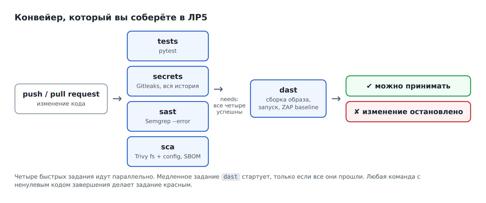
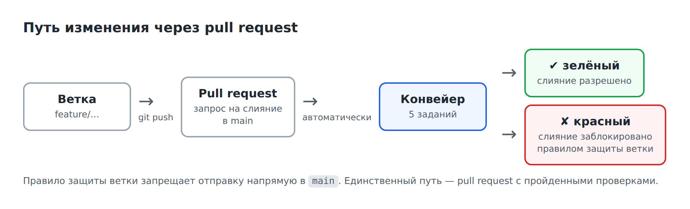

# Лабораторная работа №5. Конвейер безопасности в GitHub Actions

**Время:** 4 академических часа (два занятия).

**Что получится:** ваш проект опубликован на GitHub; на каждое изменение автоматически запускаются тесты, Gitleaks, Semgrep, Trivy и OWASP ZAP; отчёты сохраняются; уязвимое изменение конвейер не пропускает, а обойти его нельзя.

В этой работе нет новых сканеров. Вы берёте команды, которые уже выполняли руками в ЛР2–ЛР4, и заставляете их работать без вашего участия.

**Перед началом:** выполнены ЛР1–ЛР4, в репозитории семь коммитов, есть учётная запись на github.com.

---

## 1. Цель работы

Собрать из отдельных проверок единый автоматический процесс и убедиться, что он действительно останавливает небезопасные изменения.

После работы вы сможете:

- объяснить, как устроен конвейер CI и как он принимает решение «пропустить или остановить»;
- прочитать и собрать файл конвейера GitHub Actions;
- встроить в конвейер сканеры четырёх типов с порогами и сохранением отчётов;
- найти причину остановки по журналу конвейера;
- сделать проверки обязательными с помощью защиты ветки;
- оценить, что конвейер гарантирует, а что нет.

## 2. Теория

### 2.1. Зачем нужен конвейер

За четыре работы вы выполнили руками около тридцати проверок. Представьте, что это нужно делать при каждом изменении кода, а изменений — десять в день, и делают их пять разных людей. Вручную это не работает: проверки начнут пропускать уже на второй день.

**CI (Continuous Integration, непрерывная интеграция)** — практика, при которой каждое изменение кода автоматически проверяется на сервере. Цепочку автоматических шагов называют **конвейером** (pipeline).

Конвейер решает три задачи:

| Задача | Как решается |
|---|---|
| проверки выполняются всегда | запуск привязан к событию — отправке кода, а не к чьей-то памяти |
| проверки выполняются одинаково | команды и версии сканеров записаны в файле, а не в головах |
| результат нельзя проигнорировать | непройденная проверка блокирует слияние |

### 2.2. Как конвейер принимает решение

Вспомните раздел 2.6 второй работы: программа, завершаясь, возвращает число — **код завершения**. Ноль — успех, остальное — ошибка.

Это единственное, на что смотрит конвейер:

> Команда вернула 0 — шаг зелёный. Вернула не 0 — шаг красный, задание остановлено, изменение помечено как непрошедшее.

Поэтому в ЛР2–ЛР4 вы для каждого сканера выясняли, как заставить его вернуть ненулевой код:

| Сканер | Что делает проверку блокирующей |
|---|---|
| Semgrep | `--error` |
| Gitleaks | код 1 при любой находке, кроме внесённых в `.gitleaksignore` |
| Trivy | `--exit-code 1` вместе с `--severity` |
| ZAP | действие `FAIL` в файле правил |
| pytest | код 1, если хоть один тест не прошёл |

Сканер без такого параметра в конвейере — декорация: он печатает находки в журнал, который никто не читает, и пропускает изменение дальше.

### 2.3. GitHub Actions: основные понятия

GitHub Actions — система CI, встроенная в GitHub. Конвейер описывается текстовым файлом в каталоге `.github/workflows/` вашего репозитория.

| Понятие | Что это | Пример |
|---|---|---|
| **workflow** | весь конвейер; один файл | `security.yml` |
| **событие** (`on`) | что запускает конвейер | `push`, `pull_request` |
| **job** (задание) | группа шагов на отдельной виртуальной машине | `sast` |
| **step** (шаг) | одна команда или готовое действие | запуск Semgrep |
| **action** (действие) | готовый блок от GitHub или сообщества | `actions/checkout` — получить код |
| **runner** | виртуальная машина, где выполняется задание | `ubuntu-latest` |
| **artifact** | файл, сохранённый по итогам запуска | отчёт сканера, SBOM |

Важные свойства:

- каждое задание выполняется на **чистой** виртуальной машине: там нет ни вашего кода, ни сканеров, пока шаги их не получат и не установят;
- задания по умолчанию идут **параллельно**; порядок задаётся словом `needs`;
- после завершения задания машина уничтожается; всё, что нужно сохранить, выгружают как артефакт.

### 2.4. Конвейер, который вы соберёте



Принцип построения: **сначала быстрое и дешёвое, потом медленное и дорогое.** Тесты и три сканера кода занимают около минуты и идут одновременно. Задание `dast` требует собрать образ, запустить приложение с базой и просканировать его — это несколько минут. Незачем тратить их, если в коде уже нашли секрет или инъекцию. Поэтому `dast` ждёт успеха остальных.

### 2.5. Как читать файл конвейера

Файл написан на языке **YAML**. Его правила просты:

- вложенность задаётся **отступами** — только пробелами, по два на уровень;
- `ключ: значение` — пара;
- строка, начинающаяся с `- `, — элемент списка;
- `#` начинает комментарий.

Пример одного задания с пояснениями:

```yaml
jobs:
  sast:                              # имя задания
    name: SAST (Semgrep)             # как оно показывается в интерфейсе
    runs-on: ubuntu-latest           # на какой машине выполнять
    steps:                           # список шагов
      - uses: actions/checkout@v4    # готовое действие: получить код репозитория
      - name: Run Semgrep            # название шага
        run: semgrep scan --error .  # команда терминала
```

Команды после `run:` — те самые, что вы выполняли на ноутбуке. Конвейер не знает о безопасности ничего: он просто выполняет команды и смотрит на коды завершения.

### 2.6. Pull request и защита ветки

Если каждый может отправлять изменения прямо в основную ветку `main`, конвейер лишь сообщит о проблеме **после** того, как она уже попала в код.

Поэтому изменения вносят через **pull request (PR)** — запрос на слияние отдельной ветки в `main`.



Конвейер проверяет PR. **Правило защиты ветки** запрещает отправку напрямую в `main` и разрешает слияние только при пройденных проверках. Так набор сканеров превращается в **условие приёмки** (quality gate): правило «не прошёл проверку — не принят», которое исполняет не человек, а система.

### 2.7. Безопасность самого конвейера

Конвейер имеет доступ к коду и секретам проекта, поэтому сам является целью атак. Минимальные правила:

| Правило | Как реализовано у вас |
|---|---|
| наименьшие права | `permissions: contents: read` — конвейеру разрешено только читать код |
| точные версии сканеров и действий | `aquasec/trivy:0.76.2`, `actions/checkout@v4`, Semgrep и Gitleaks с номерами версий |
| секреты — только в защищённом хранилище | GitHub Secrets; в тексте конвейера и в коде секретов нет |
| сбой сканера — не «всё чисто» | если сканер не смог отработать, шаг красный: проверка не выполнена |
| отчёты сохраняются всегда | `if: always()` у шагов выгрузки артефактов |

Про версии. Сканер или готовое действие — такая же зависимость, как библиотека. Он получает доступ к вашему коду, и известны случаи подмены опубликованных версий популярных инструментов. В промышленных проектах действия фиксируют ещё строже — по хешу коммита.

### 2.8. Что конвейер гарантирует, а что нет

Зелёный конвейер означает ровно одно: **проверки, которые в него встроены, не нашли того, что они умеют находить.**

Он не означает, что приложение безопасно. Вспомните чужой профиль из ЛР4: ни один сканер его не увидел, и конвейер ловит его только потому, что вы добавили тесты. Пароли в открытом виде не проверяет ничто. Конвейер закрепляет достигнутое и не даёт вернуться назад — но не заменяет анализа человеком.

---

## 3. Ход работы

```bash
cd ~/devsecops-lab
source .venv/Scripts/activate     # Windows, Git Bash
# source .venv/bin/activate       # Linux и macOS
export MSYS_NO_PATHCONV=1         # только Windows, Git Bash
```

### Шаг 1. Проверить готовность проекта

Прежде чем публиковать, убедитесь, что все проверки проходят локально. Это те же команды, которые войдут в конвейер.

```bash
git status
git log --oneline
pytest -q
semgrep scan --config .semgrep.yml --metrics=off --error -q . ; echo "Semgrep: $?"
docker run --rm -v "$PWD:/src" ghcr.io/gitleaks/gitleaks:v8.24.2 git --redact /src ; echo "Gitleaks: $?"
```

**Что увидите:**

- `working tree clean`, семь коммитов;
- `11 passed`;
- `Semgrep: 0`;
- `no leaks found`, `Gitleaks: 0`.

Проверка Gitleaks перед публикацией — не формальность. После `git push` история окажется на чужом сервере, и вернуть секрет будет нельзя.

Если какая-то проверка не проходит — вернитесь к соответствующей работе. Публиковать «красный» проект бессмысленно: конвейер будет красным с первого запуска.

**В отчёт:** вывод команд.

### Шаг 2. Опубликовать проект на GitHub

На сайте:

1. Войдите на <https://github.com>, нажмите **+** справа вверху → **New repository**.
2. **Repository name:** `devsecops-lab`.
3. Видимость: **Public** — для публичных репозиториев GitHub Actions бесплатны и доступна защита веток.
4. Галочки **Add a README file**, **.gitignore**, **license** не ставьте: репозиторий должен быть пустым.
5. Нажмите **Create repository**.

В терминале (подставьте свой логин):

```bash
git remote add origin https://github.com/<ваш_логин>/devsecops-lab.git
git push -u origin main
```

| Команда | Смысл |
|---|---|
| `git remote add origin …` | запомнить адрес репозитория на GitHub под именем `origin` |
| `git push -u origin main` | отправить ветку `main` со всей историей |

Git попросит войти в GitHub — откроется окно браузера. Если вместо этого в терминале запрашивается пароль, нужен токен доступа: **Settings → Developer settings → Personal access tokens**. Вводите его только в ответ на запрос. Не вставляйте токен в адрес репозитория и не сохраняйте в файлах проекта — после ЛР3 вы знаете почему.

**Что увидите:** обновите страницу репозитория — на ней ваши файлы и надпись `7 Commits`.

**В отчёт:** ссылка на репозиторий.

### Шаг 3. Первое задание: тесты

Создайте каталог для конвейера:

```bash
mkdir -p .github/workflows
```

Создайте в редакторе файл `.github/workflows/security.yml`:

```yaml
name: security-pipeline

on:
  push:
    branches: [main]
  pull_request:
  workflow_dispatch:

permissions:
  contents: read

jobs:
  tests:
    name: Unit tests
    runs-on: ubuntu-latest
    steps:
      - uses: actions/checkout@v4
      - uses: actions/setup-python@v5
        with:
          python-version: "3.11"
          cache: pip
      - name: Install dependencies
        run: python -m pip install -r requirements.txt -r requirements-dev.txt
      - name: Run tests
        run: pytest -q
```

Разбор по строкам:

| Строка | Смысл |
|---|---|
| `name:` | название конвейера |
| `on:` | когда запускать: при отправке в `main`, при любом pull request, вручную (`workflow_dispatch`) |
| `permissions: contents: read` | конвейеру разрешено только читать код |
| `jobs:` | начало списка заданий |
| `tests:` | имя первого задания |
| `runs-on: ubuntu-latest` | чистая виртуальная машина с Linux |
| `actions/checkout@v4` | получить код репозитория — без этого шага на машине пусто |
| `actions/setup-python@v5` | установить Python 3.11 |
| `run:` | команда терминала |

Отправьте файл:

```bash
git add -A
git commit -m "ci: add unit tests job"
git push
```

**В отчёт:** текст файла на этом этапе не нужен — полный текст вы приведёте в конце.

### Шаг 4. Научиться читать запуск

Откройте на GitHub вкладку **Actions** своего репозитория.

1. Слева — список конвейеров, в центре — список запусков. Найдите запуск с названием вашего коммита `ci: add unit tests job`.
2. Жёлтый кружок — выполняется; зелёная галочка — успех; красный крестик — ошибка.
3. Щёлкните по запуску. Откроется страница с заданиями.
4. Щёлкните по заданию **Unit tests**. Откроется журнал: список шагов, каждый можно развернуть.
5. Разверните шаг **Run tests** и найдите строку `11 passed`.

Запустите конвейер вручную: вкладка **Actions** → слева `security-pipeline` → справа кнопка **Run workflow** → **Run workflow**. Это работает благодаря строке `workflow_dispatch`.

Если запуск красный — разверните упавший шаг и прочитайте последние строки. Самая частая причина на этом шаге — отступы YAML: сообщение об ошибке укажет номер строки.

**В отчёт:** снимок экрана зелёного запуска с развёрнутым шагом `Run tests`.

### Шаг 5. Задание: поиск секретов

Добавьте в **конец** файла `security.yml` второе задание. Слово `secrets:` должно стоять с тем же отступом, что и `tests:`, — два пробела.

```yaml
  secrets:
    name: Secrets (Gitleaks)
    runs-on: ubuntu-latest
    steps:
      - uses: actions/checkout@v4
        with:
          fetch-depth: 0
      - name: Install Gitleaks
        run: |
          curl -sSfL https://github.com/gitleaks/gitleaks/releases/download/v8.24.2/gitleaks_8.24.2_linux_x64.tar.gz \
            | sudo tar -xz -C /usr/local/bin gitleaks
      - name: Scan Git history
        run: |
          mkdir -p reports
          gitleaks git --redact --no-banner --report-format json --report-path reports/gitleaks.json .
      - name: Upload report
        if: always()
        uses: actions/upload-artifact@v4
        with:
          name: gitleaks-report
          path: reports/
```

| Строка | Смысл |
|---|---|
| `fetch-depth: 0` | получить **всю** историю. По умолчанию `checkout` берёт один последний коммит — и проверять историю было бы не на чем |
| `Install Gitleaks` | скачать сканер той же версии 8.24.2, что в `.pre-commit-config.yaml` |
| `run: \|` | вертикальная черта — «дальше несколько строк команд» |
| `gitleaks git …` | та же команда, что в ЛР3 |
| `if: always()` | выполнить шаг, даже если предыдущий упал: отчёт нужнее всего именно тогда |
| `upload-artifact` | сохранить папку `reports` как артефакт запуска |

Файл `.gitleaksignore` из ЛР3 сканер учтёт автоматически — он лежит в репозитории.

### Шаг 6. Задание: статический анализ

Добавьте в конец файла:

```yaml
  sast:
    name: SAST (Semgrep)
    runs-on: ubuntu-latest
    steps:
      - uses: actions/checkout@v4
      - uses: actions/setup-python@v5
        with:
          python-version: "3.11"
          cache: pip
      - name: Install Semgrep
        run: python -m pip install -r requirements-dev.txt
      - name: Run Semgrep
        run: |
          mkdir -p reports
          semgrep scan --config .semgrep.yml --metrics=off --error --json-output reports/semgrep.json .
      - name: Upload report
        if: always()
        uses: actions/upload-artifact@v4
        with:
          name: semgrep-report
          path: reports/
```

Команда `semgrep scan` — та, что вы собрали на шаге 9 второй работы. Версия Semgrep берётся из `requirements-dev.txt`.

### Шаг 7. Задание: зависимости, Dockerfile и SBOM

Добавьте в конец файла:

```yaml
  sca:
    name: SCA and SBOM (Trivy)
    runs-on: ubuntu-latest
    env:
      TRIVY_IMAGE: aquasec/trivy:0.76.2
    steps:
      - uses: actions/checkout@v4
      - name: Scan dependencies
        run: |
          mkdir -p reports && chmod 777 reports
          docker run --rm -v "$PWD:/src" "$TRIVY_IMAGE" fs --scanners vuln \
            --severity HIGH,CRITICAL --exit-code 1 /src
      - name: Check Dockerfile
        run: docker run --rm -v "$PWD:/src" "$TRIVY_IMAGE" config --exit-code 1 /src
      - name: Generate SBOM
        run: |
          docker run --rm -v "$PWD:/src" "$TRIVY_IMAGE" fs --format cyclonedx \
            --output /src/reports/sbom.cdx.json /src
      - name: Upload SBOM
        if: always()
        uses: actions/upload-artifact@v4
        with:
          name: sbom
          path: reports/
```

| Строка | Смысл |
|---|---|
| `env: TRIVY_IMAGE: …` | переменная с именем и версией образа, чтобы не повторять её в каждой команде |
| `Scan dependencies` | порог из ЛР3: HIGH и CRITICAL блокируют |
| `Check Dockerfile` | проверка из ЛР4: любая находка блокирует |
| `Generate SBOM` | опись компонентов сохраняется при каждом запуске |

Отправьте три новых задания:

```bash
git add -A
git commit -m "ci: add Gitleaks, Semgrep and Trivy jobs"
git push
```

**Что увидите** на вкладке Actions: четыре задания, выполняются одновременно, все зелёные. Общее время — 1–2 минуты.

Заполните таблицу для отчёта — она показывает, что в конвейере нет ничего нового:

| Задание | Команда сканера | Что делает проверку блокирующей | Из какой работы |
|---|---|---|---|
| `tests` | `pytest -q` | код 1 при упавшем тесте | ЛР2, ЛР4 |
| `secrets` | | | |
| `sast` | | | |
| `sca` | | | |

**В отчёт:** таблица, снимок экрана запуска с четырьмя зелёными заданиями.

### Шаг 8. Скачать и проверить артефакты

Откройте страницу последнего запуска и прокрутите вниз до раздела **Artifacts**. Там три архива: `gitleaks-report`, `semgrep-report`, `sbom`.

1. Скачайте `sbom`, распакуйте, откройте `sbom.cdx.json`. Сравните с `reports/sbom-after.cdx.json` из ЛР3: формат и число компонентов совпадают?
2. Скачайте `semgrep-report`. Найдите в JSON поле `results` — оно пустое: находок нет.

Зачем хранить отчёт, в котором нет находок? Это **свидетельство**: в такой-то день, для такого-то коммита, такой-то версией сканера с такими-то правилами проверка выполнена и ничего не нашла. Требование ГОСТ Р 71207-2024 о фиксации результатов анализа выполняется автоматически.

**В отчёт:** снимок экрана раздела Artifacts, ответы на вопрос о совпадении SBOM.

### Шаг 9. Задание: запуск приложения и DAST

Добавьте в конец файла последнее задание:

```yaml
  dast:
    name: Container and DAST (ZAP)
    runs-on: ubuntu-latest
    needs: [tests, secrets, sast, sca]
    steps:
      - uses: actions/checkout@v4
      - name: Start application
        run: docker compose up -d --build --wait
      - name: Smoke test
        run: curl --fail --silent http://127.0.0.1:5000/health
      - name: ZAP baseline scan
        run: |
          mkdir -p reports
          cp zap-rules.tsv reports/
          chmod -R 777 reports
          docker run --rm --network host -v "$PWD/reports:/zap/wrk/:rw" \
            ghcr.io/zaproxy/zaproxy:stable zap-baseline.py \
            -t http://127.0.0.1:5000 -c zap-rules.tsv -r zap-report.html -I
      - name: Stop application
        if: always()
        run: docker compose down -v
      - name: Upload ZAP report
        if: always()
        uses: actions/upload-artifact@v4
        with:
          name: zap-report
          path: reports/
```

| Строка | Смысл |
|---|---|
| `needs: [tests, secrets, sast, sca]` | запускать только после успеха четырёх заданий |
| `Start application` | собрать образ и запустить приложение с базой — как в ЛР4 |
| `Smoke test` | убедиться, что приложение отвечает; `--fail` даёт код ошибки, если нет |
| `ZAP baseline scan` | сканирование с вашим файлом правил `zap-rules.tsv` |
| `Stop application` | остановить контейнеры в любом случае |

```bash
git add -A
git commit -m "ci: add container start and ZAP baseline"
git push
```

**Что увидите:** на странице запуска — схема: четыре задания слева, от них линии к `Container and DAST (ZAP)` справа. Пятое задание стартует после остальных. Общее время — 3–5 минут.

Откройте журнал `dast` → шаг **ZAP baseline scan**, найдите итоговую строку `FAIL-NEW: 0 … WARN-NEW: 4 … IGNORE: 2` и сравните с результатом шага Б8 четвёртой работы.

**В отчёт:** снимок экрана схемы заданий, итоговая строка ZAP из журнала.

### Шаг 10. Опыт: внести уязвимость

Конвейер, который ни разу не покраснел, ещё ничего не доказал. Сыграйте роль разработчика, который вернул уязвимую версию страницы комментариев.

Создайте ветку и скопируйте исходный, уязвимый файл из материалов курса:

```bash
git switch -c feature/rich-comments
cp ../secure-development-labs/vulnerable-app/frontend/templates/comments.html frontend/templates/
git diff
```

**Что увидите:** вернулся фильтр `|safe` — тот самый XSS из ЛР1.

```bash
git add -A
git commit -m "Allow rich text in comments"
git push -u origin feature/rich-comments
```

Обратите внимание: локальный хук коммит пропустил. Он ищет секреты, а не XSS.

На GitHub: на странице репозитория появится жёлтая полоса с кнопкой **Compare & pull request**. Нажмите её, затем **Create pull request**.

**Что увидите** через 1–2 минуты внизу страницы PR:

- `Unit tests` — красный;
- `SAST (Semgrep)` — красный;
- `Secrets (Gitleaks)`, `SCA and SBOM (Trivy)` — зелёные;
- `Container and DAST (ZAP)` — пропущено (Skipped): сработало `needs`.

**В отчёт:** снимок экрана PR с результатами проверок.

### Шаг 11. Найти причину по журналу

Это главный практический навык работы с конвейером: по красному крестику дойти до конкретной строки кода.

Щёлкните **Details** рядом с `SAST (Semgrep)`. Разверните шаг **Run Semgrep**. Найдите:

- идентификатор правила;
- файл и номер строки;
- текст строки кода.

Затем откройте журнал `Unit tests`, шаг **Run tests**. Найдите:

- имя упавшего теста;
- строку с `assert`, которая не выполнилась.

Заполните таблицу:

| Задание | Что именно сообщило о проблеме | Файл и строка |
|---|---|---|
| `SAST (Semgrep)` | правило … | |
| `Unit tests` | тест … | |

Ответьте: уязвимость поймали две независимые проверки. Какая из них сработала бы, не будь в проекте тестов? А если бы в `.semgrep.yml` не было правила про `safe`? Что это говорит о том, зачем нужны несколько проверок?

**В отчёт:** таблица, фрагменты двух журналов, ответ.

### Шаг 12. Исправить и принять

Верните исправленную версию в ту же ветку:

```bash
cp ../secure-development-labs/solutions/lab2/frontend/templates/comments.html frontend/templates/
git add -A
git commit -m "Revert unsafe filter"
git push
```

**Что увидите:** PR перепроверился сам — новый запуск начался после `git push`. Все пять проверок зелёные.

Нажмите **Merge pull request** → **Confirm merge**. Затем обновите локальную копию:

```bash
git switch main
git pull
```

**В отчёт:** снимок экрана зелёного PR.

### Шаг 13. Сделать проверки обязательными

На шаге 10 кнопка **Merge pull request** была доступна и при красных проверках — GitHub лишь предупреждал. Закройте эту возможность.

На GitHub: **Settings** → слева **Rules** → **Rulesets** → **New ruleset** → **New branch ruleset**.

1. **Ruleset Name:** `protect-main`.
2. **Enforcement status:** `Active`.
3. **Target branches** → **Add target** → **Include default branch**.
4. Включите **Require a pull request before merging**.
5. Включите **Require status checks to pass**. Нажмите **Add checks** и добавьте пять проверок: `Unit tests`, `Secrets (Gitleaks)`, `SAST (Semgrep)`, `SCA and SBOM (Trivy)`, `Container and DAST (ZAP)`.
6. Нажмите **Create**.

Проверьте, что правило действует. Попробуйте отправить изменение прямо в `main`:

```bash
echo "# test" >> README-test.md
git add -A
git commit -m "Direct push test"
git push
```

**Что увидите:** отказ с сообщением вроде `push declined due to repository rule violations`.

Отмените пробный коммит:

```bash
git reset --hard origin/main
```

Теперь изменение попадает в `main` только через pull request и только с зелёным конвейером. Набор сканеров стал условием приёмки.

**В отчёт:** снимок экрана правила и сообщение об отказе.

### Шаг 14. Итог практикума

Вернитесь к таблице из ЛР1 (шаг 9) и заполните, что оказалось на самом деле:

| № | Проблема | Чем найдена на самом деле | Исправлена? | Каким заданием конвейера контролируется |
|---|---|---|---|---|
| 1 | SQL-инъекция | Semgrep; вручную | да, ЛР2 | `sast`, `tests` |
| 2 | XSS | | | |
| 3 | Чужой профиль без входа | | | |
| 4 | Отладочный режим | | | |
| 5 | Токен в коде | | | |
| 6 | Старые библиотеки | | | |
| 7 | Открыт порт базы данных | | | |
| 8 | Пароли открытым текстом | | | |

Сравните с вашей гипотезой из ЛР1. Где вы ошиблись? Какие проблемы не нашёл ни один сканер?

Составьте реестр остаточных рисков — того, что осталось неисправленным:

| Риск | Почему остался | Что нужно сделать |
|---|---|---|
| Пароли хранятся открытым текстом | ни один сканер не сообщил | хранить хеши паролей |
| Нет защиты от CSRF | ZAP 10202, оставлено предупреждением | добавить токены в формы |
| Ключ сессии по умолчанию | | |
| Уязвимости базового образа без исправлений | | |
| Не проверяются страницы после входа | | |

И ответьте на главный вопрос практикума в 5–7 предложениях:

> Конвейер зелёный. Можно ли выпускать приложение в эксплуатацию? Что зелёный конвейер гарантирует и чего не гарантирует?

**В отчёт:** таблица, реестр, ответ.

## 4. Дополнительные задания

По желанию, оцениваются отдельно.

1. **Dependabot.** Добавьте файл `.github/dependabot.yml` для экосистем `pip` и `github-actions`. Покажите созданный Dependabot pull request и результат его проверки вашим конвейером.
2. **Сканирование образа в конвейере.** Добавьте в задание `dast` шаг с `trivy image --severity HIGH,CRITICAL --ignore-unfixed --exit-code 1`. Обоснуйте выбор порога по результатам ЛР4.
3. **Готовые правила Semgrep.** Добавьте в `sast` второй шаг с `--config p/default` и подавлением ложного срабатывания из ЛР2. Сделайте его неблокирующим (без `--error`). Объясните, почему так.
4. **Запуск по расписанию.** Добавьте в `on:` запуск раз в сутки (`schedule`). Объясните, зачем проверять проект, в котором ничего не меняли. Подсказка: ЛР3, раздел 2.7.

## 5. Требования к отчёту

1. Результаты локальной проверки перед публикацией.
2. Ссылка на репозиторий.
3. Полный текст `security.yml`.
4. Таблица «задание — команда — что блокирует — из какой работы».
5. Снимки экрана: первый зелёный запуск; запуск с пятью заданиями и схемой; раздел Artifacts.
6. Опыт с уязвимым изменением: красный PR, таблица с причинами из журналов, зелёный PR.
7. Правило защиты ветки и сообщение об отказе в прямой отправке.
8. Итоговая таблица, реестр остаточных рисков, ответ о выпуске.
9. Ответы на контрольные вопросы.

## 6. Контрольные вопросы

1. Какие три задачи решает конвейер CI?
2. Как GitHub Actions понимает, что шаг провален?
3. Почему сканер без `--error` или `--exit-code` в конвейере бесполезен?
4. Зачем заданию `secrets` параметр `fetch-depth: 0`?
5. Что изменится, если убрать `needs` у задания `dast`?
6. Зачем `if: always()` у шага выгрузки отчёта?
7. Зачем сохранять отчёт, в котором нет находок?
8. Почему локальный хук pre-commit пропустил уязвимое изменение на шаге 10?
9. Что даёт защита ветки, чего не даёт сам конвейер?
10. Почему в конвейере указаны точные версии сканеров и `permissions: contents: read`?
11. Сканер в конвейере не смог скачать базу уязвимостей и завершился с ошибкой. Как это трактовать?
12. Конвейер зелёный. Означает ли это, что приложение безопасно и соответствует ГОСТ Р 56939-2024?

## 7. Критерии оценивания

| Критерий | Баллы |
|---|---|
| Проверка готовности, публикация на GitHub | 10 |
| Задание с тестами, чтение запуска | 10 |
| Три сканера, таблица, артефакты | 20 |
| Задание DAST с `needs` и файлом правил | 10 |
| Опыт с уязвимым изменением: красный PR, причина по журналам, зелёный PR | 20 |
| Защита ветки | 10 |
| Итог практикума: таблица, остаточные риски, ответ о выпуске | 15 |
| Контрольные вопросы | 5 |
| **Итого** | **100** |

## 8. Источники

- ГОСТ Р 56939-2024. Разработка безопасного программного обеспечения. Общие требования.
- Документация GitHub Actions: <https://docs.github.com/actions>
- Синтаксис файла конвейера: <https://docs.github.com/actions/reference/workflow-syntax-for-github-actions>
- Правила защиты веток: <https://docs.github.com/repositories/configuring-branches-and-merges-in-your-repository/managing-rulesets/about-rulesets>
- Усиление безопасности GitHub Actions: <https://docs.github.com/actions/security-for-github-actions/security-guides/security-hardening-for-github-actions>
